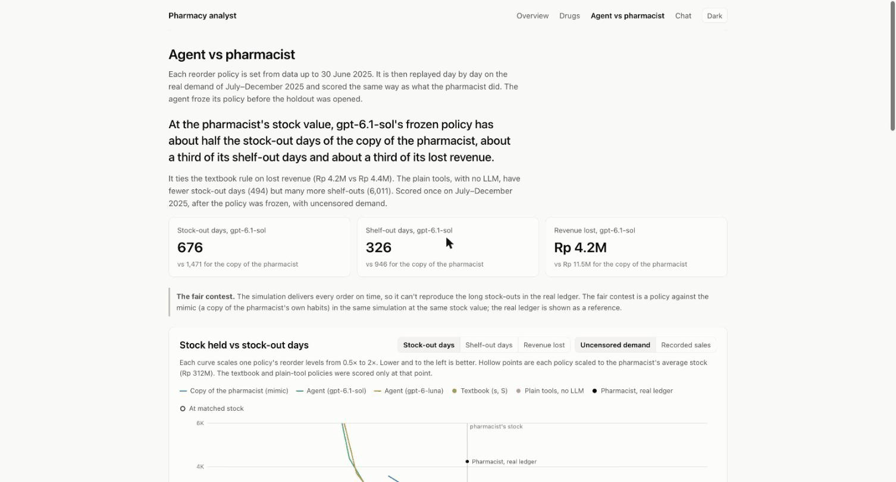
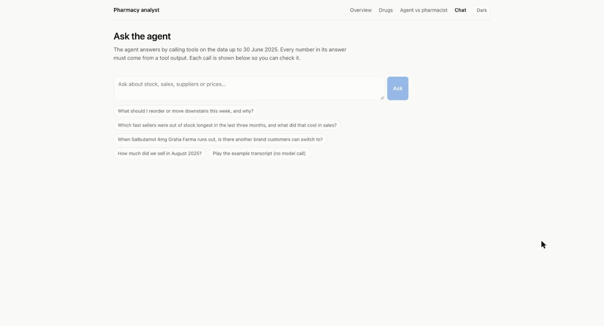

# IRPD pharmacy analysis

A study of where one Indonesian pharmacy loses sales, and an AI assistant that
answers questions about it. It is built on three years of the pharmacy's sales
and full stock ledger ([IRPD](#data), CC BY 4.0). The assistant answers by
calling tools over a DuckDB warehouse, and every number it states has to come
from a tool. Everything is built from data up to 30 June 2025. The second half
of 2025 is sealed in a file only the scorer can open, and is used to score
reorder policies against the pharmacist's.

A few terms used below. A stock-out is a day when the whole pharmacy has none
of a drug. A shelf-out is a day when the shop floor is empty but the upstairs
store still has some. Fast and regular drugs are the ones that sell on at
least 3 days a week or at least once a week. The agent runs on two OpenAI
models: gpt-6.1-sol, the larger one, and gpt-6-luna, about 15 times cheaper.



## What it found

Rp 194M of sales were lost to stock-outs and shelf-outs from October 2023 to
the cutoff, 2.75% of revenue. A fake stock-out test checks the estimate: it
lands within 1% on fast drugs and 6% on regular ones.

Only about 30% of those lost sales moved to another brand of the same
medicine, not the 84% the first look suggested. It depends on the medicine:
nearly everyone switches for amlodipine, almost no one for paracetamol. So
Rp 163M (2.3%) was truly lost.

Consistent reorder rules beat the pharmacist's habits by a wide margin, with or
without AI. Each policy was set from data up to 30 June 2025, then replayed on
the sealed H2 2025 data at the pharmacist's stock value (about Rp 312M). A
textbook reorder rule, with no AI, lost 62% less revenue than a copy of the
pharmacist's habits. The agent's policy (on gpt-6.1-sol) lost 63% less, which
is a tie with the textbook rule. Where the agent did pull ahead was shelf-outs,
through a rule that keeps more stock on the shop floor. That win is an upper
bound, because the simulated floor has no space limit.

Better forecasting barely helps here. A machine-learning model trained on every
drug at once (LightGBM) was only slightly more accurate than simple per-drug
smoothing, and its reorder plans lost about the same revenue. Both forecasts are
close to flat lines, and that is correct for this data. Outside Eid, a drug's
week-to-week ups and downs are mostly random, so the best forecast is a good
estimate of its normal level. The reorder rule covers the randomness with a
safety buffer. Eid is the one peak worth forecasting. Both models raise their forecast for it,
though both put the 2025 peak a week late.

The replay sets each policy once for six months and rescales it to the
pharmacist's stock value. That makes it good at showing large gaps, like rules
against habit, and weak at telling close methods apart, like one forecaster
against another. See [Results](docs/results.md).

The agent doesn't make numbers up. Over the 91 eval questions, gpt-6-luna
stated a number that no tool produced in 2 answers. It turned down every
question about profit, margin or dates past the cutoff. At first it didn't
check false claims in a question. The last prompt revision fixed that.

The bigger model only helped with planning. On questions, gpt-6.1-sol and
gpt-6-luna both scored 90%. On the reorder policy, sol had 326 shelf-out days
to luna's 3,635.



## More detail

- [Results](docs/results.md): the contest table and its caveats, lost demand,
  switching, forecasting, both eval sets, and what the data can't tell us.
- [How it works](docs/how-it-works.md): the warehouse, the sealed holdout, the
  tools, the agent loop, the forecaster, the replay, and every command.
- [FINDINGS.md](FINDINGS.md): the exploratory analysis.
- [eda/followup](eda/followup/): follow-up work on the demand patterns: why
  the forecasts are flat, how forecasts reach reorder decisions, and the fixes
  we tried.

## Quick start

Needs Python 3.11+, [uv](https://docs.astral.sh/uv/) and Node.

```sh
uv sync
# download the data into data/raw/irpd/ (see Data below)
uv run irpd build                   # warehouse + sealed holdout, a few seconds
uv run irpd replay --uncensored     # the replay table on H2 2025
uv sync --extra ml && uv run irpd ml serve   # optional: ML forecasts, ~1 min
uv run irpd ml rolling              # optional: H2 2025 forecast history, ~10 min
uv run uvicorn irpd.api.app:app --port 8000
cd web && npm install && npm run dev   # http://localhost:5173
```

Model calls need `OPENAI_API_KEY` in a `.env` file. Without one, the chat page
plays an example transcript.

## Data

[IRPD: Indonesian Retail Pharmacy Sales and Stock Transaction Dataset (2023–2025)](https://data.mendeley.com/datasets/w6zjtdjk9m/1),
CC BY 4.0. It is not committed. Download the zip from the Mendeley page and
unzip it so that `data/raw/irpd/raw_dataset/` and
`data/raw/irpd/processed_dataset/` exist.

Two reference drug lists are used to check the ingredient mapping. They are
not committed either.

- [Indonesian Pharmaceutical Dataset](https://data.mendeley.com/datasets/z45bptxptf/2),
  CC BY 4.0. Put `processed_data_obat.csv` in `data/reference/indo_pharma/`.
- [FDA National Drug Code directory](https://www.fda.gov/drugs/drug-approvals-and-databases/national-drug-code-directory),
  public domain. Unzip `ndctext.zip` into `data/reference/fda_ndc/`.

Then run `uvx --with duckdb --with pandas python -I scripts/build_reference_labels.py`.

## Licence

The code is MIT licensed (see [LICENSE](LICENSE)). The IRPD data and the
reference drug lists keep their own licences, credited above.
