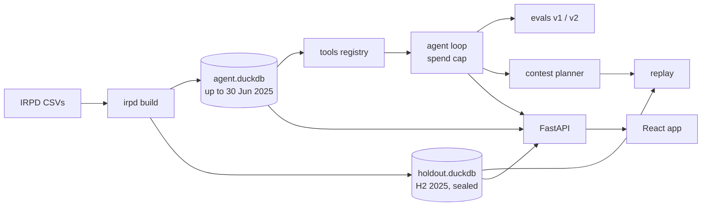

# How it works



## Warehouse

`irpd build` loads the raw sales and stock files into DuckDB and builds 18
tables: daily stock per location (shop floor and upstairs store), stock-out
and shelf-out spells, purchases, transfers, stock-takes, prices, pack sizes,
demand tiers and the ingredient map. `warehouse.as_of(day)` returns a
connection where every table is a view that stops at that day. A test
rebuilds small fixtures cut at every day and checks the views show nothing
more than the cut build.

## Data decisions

What the exploratory analysis ([FINDINGS.md](../FINDINGS.md)) found, and what
the build does about it.

| Finding | Decision |
|---|---|
| The processed stock file merges the shop floor and the upstairs store. Its end-of-day balance is wrong on 36% of drug-days for drugs that use the store | Build stock from the raw file, per location, then sum per drug per day |
| Some drugs are sold by the strip or box while the ledger counts tablets or sachets | Take demand from the ledger's sale rows (`StockOut`), in base units. Keep a pack-size table for prices |
| No cost or purchase-price data | Track revenue, not profit. Value stock at the median selling price, and say so |
| A few drugs started with years of stock on the books until counts in July–September 2023 | Start stock analysis after September 2023 and flag those drugs |
| Negative stock is mostly a sale rung up minutes before stock was booked in | Use end-of-day stock. Flag the few days that close negative |
| About 38% of all drug-days are at zero, mostly slow drugs that ran out and weren't restocked | Measure stock-outs only inside each drug's selling period, by demand tier |
| Daily demand is mostly intermittent. Weekly, about 520 drugs are smooth and make about 60% of revenue | Forecast weekly, with Eid windows (7 days before to 28 after) as features. No illness seasons |
| Prices rise a little after deliveries, with no detectable demand response | Show price history. Don't model a price response |
| `Manufacturer` is blank for 71% of revenue. `ShiftPeriod` is a label, not the time of day | Don't build questions on them. Use the hour for time of day |
| Returns are only in the ledger | Sales revenue is slightly overstated. Say so |

## Sealed holdout

The build then splits the warehouse in two. `agent.duckdb` holds every table
as of the cutoff and nothing after. `holdout.duckdb` holds H2 2025, and only
the replay opens it. The agent's connection has external file access switched
off and locked, so its SQL can't attach the holdout file either. Tests check
both.

## Tools

Nine plain functions register themselves with the loop: `run_sql`,
`find_drug`, `stock_position`, `stockout_history`, `alternatives`,
`forecast`, `reorder_plan`, `transfer_plan` and `price_history`. Each takes
the agent's dated connection, so a tool can't see past the day the agent
stands on.

## Agent loop and spend cap

The loop ([`src/irpd/agent/loop.py`](../src/irpd/agent/loop.py)) uses the
OpenAI Responses API with tool calls. Every model call in the project, from
the agent, the evals, the contest planner or the ingredient mapping, goes
through `irpd.llm`. It logs tokens and cost to a spend ledger and checks a
hard cap before each call. The check adds the call's worst case (its input
plus its full output limit) to what has been spent so far, and refuses the
call if that would pass the cap. So the cap holds even if a call runs to its
output limit.

## Forecaster

The forecaster ([`src/irpd/forecast.py`](../src/irpd/forecast.py)) is weekly
and works by demand tier. Fast, regular and slow drugs get exponential
smoothing with an Eid uplift. Rare drugs get a seasonal naive forecast.
Stock-out weeks are left out of fitting. It beats a plain 8-week average by
only 1-2 points of weighted percentage error. Its value is elsewhere: it is
unbiased in Eid weeks, and its 90th-percentile forecast covers about 90% of
weeks at every horizon, which is what reorder points need.

The ML forecaster ([`src/irpd/ml/`](../src/irpd/ml/)) is one LightGBM model
for every drug. Each row is a drug, a forecast date and a week ahead (1 to 8).
The features are the drug's own sales history, stock-outs, price, store
traffic, its tier and form, and the Eid calendar. Its setup is frozen in the
private lab notes: Tweedie loss, default settings, three seeds. Its spread uses
the same negative binomial recipe as the current method, so both plug into the
same reorder rule. The panel builder has leak tests: every feature must match
when the data is cut at the forecast date.

- `irpd ml serve` trains it on data up to 30 June 2025 and saves eight weeks of
  forecasts for the app. It takes about a minute.
- `irpd ml rolling` forecasts every week of H2 2025 with both methods,
  retraining each week, for the drug page's holdout view. It takes about
  10 minutes.

Without these files the app shows the current method only. How the two compare,
and why both are nearly flat, is in
[results.md](results.md#forecasting).

[`src/irpd/evalx/`](../src/irpd/evalx/) scores forecasts the way the reorder
rule uses them. It covers pinball loss and coverage of lead-time totals, a
bootstrap over both forecast dates and drugs, and a replay that re-plans every
14 days. The follow-up analysis in [eda/followup](../eda/followup/) uses it.
Options in `forecast.py` and `src/irpd/ml/` cover the fixes it tested: Eid day
counts and a units-based Eid profile, censoring-aware training targets, and a
TSB forecaster for fading drugs. All of them are off by default.

## Lost demand

[`src/irpd/lost.py`](../src/irpd/lost.py) estimates the missed sales and the
switching share, as described in [results.md](results.md#lost-demand).
`irpd replay --uncensored` uses it to put the missed demand back into H2 2025.

## Replay

The replay ([`src/irpd/replay.py`](../src/irpd/replay.py)) runs a policy
day by day from the real stock on 30 June. A policy is an (s, S) rule per
drug (reorder when stock falls to s, order up to S) plus a floor rule (when to
move stock down from the store, and how much). Each day,
deliveries arrive, the floor is topped up from the store, stock-takes apply,
sales are capped by floor stock, and orders go out in the evening. The August
2025 full stock count and the store coming back into use in July are taken as
given.

## API and web app

A read-only FastAPI service ([api.md](api.md)) keeps what the agent saw apart
from the holdout. A React app ([web/README.md](../web/README.md)) has an
overview, a drug page with stock-outs and shelf-outs shaded, the agent vs
pharmacist page, and a chat that streams the agent's tool calls as they
happen.

Tests cover the tables, the `as_of` cut, the seal, the tools, the scorers and
the replay.

## How it was built

The parts were built in parallel by coding agents, each in its own git
worktree off a `dev` branch. Each part had its own module and tests, so no
two parts edited the same files. A part was merged into `dev` only after the
full test suite passed.

## How to run it

Needs Python 3.11+, [uv](https://docs.astral.sh/uv/), and Node for the web app.

```sh
uv sync
# download the data into data/raw/irpd/ (see Data in the README)
uv run irpd build                     # warehouse + sealed holdout, a few seconds
uv run irpd replay                    # mimic and textbook vs the ledger on H2 2025
uv run irpd replay --uncensored       # the same, with lost demand added back
uv run pytest

# Optional: the ML forecaster (Forecasts page and drug page)
uv sync --extra ml
uv run irpd ml serve                  # about a minute
uv run irpd ml rolling                # about 10 minutes
```

Anything that calls a model needs `OPENAI_API_KEY` in a `.env` file at the
repo root. Spend is logged to `data/spend.jsonl` and capped at $1.
`uv run irpd spend` shows the total against the cap.

`map-ingredients` scores its answers against the reference labels, so build
those first (see [Data](../README.md#data) in the README).

```sh
uv run irpd map-ingredients --model luna       # drug name -> ingredients
uv run irpd build                              # rebuild so the warehouse picks up the map
uv run irpd evals --set v1 --model luna        # or --set v2, --split dev|test, --dry-run
uv run irpd contest plan --model gpt-6.1-sol   # the agent writes and freezes its H2 policy
uv run irpd contest score <run_id>             # score a frozen run on the sealed holdout
```

Eval answers are cached per question, model and prompt version, so a rerun
only pays for new questions. `--dry-run` prints the cost estimate and stops.

To run the app:

```sh
uv run uvicorn irpd.api.app:app --port 8000   # the API
cd web && npm install && npm run dev          # http://localhost:5173
```

Without a key, the chat page can play an example transcript instead.
