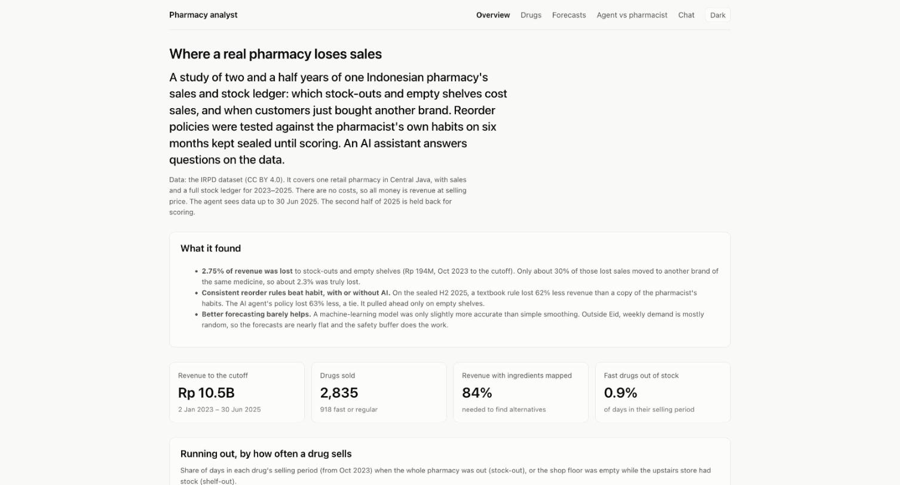
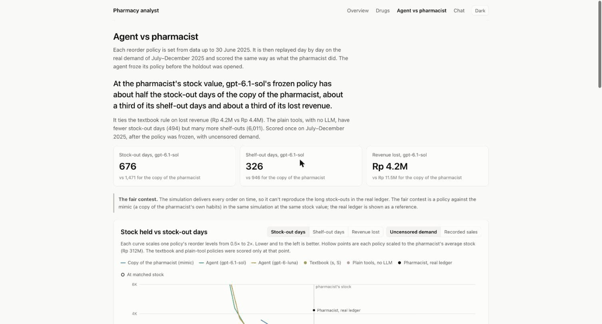
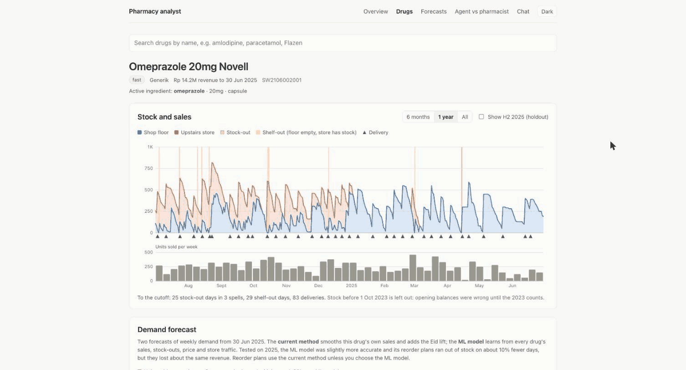
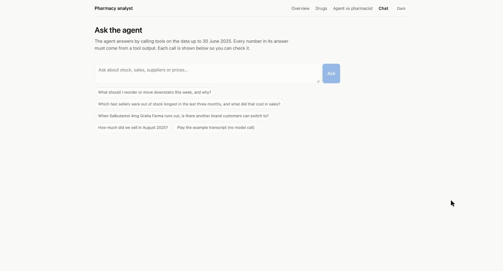

# Results

The agent sees data up to 30 June 2025. The sealed second half of 2025 is
used only for scoring. How the pieces work is in
[how-it-works.md](how-it-works.md).

Some terms. A stock-out is a day when the whole pharmacy has none of a drug.
A shelf-out is a day when the shop floor is empty but the upstairs store
still has some. Drugs fall into demand tiers by how often they sell: fast
(on at least 156 days a year), regular (52), slow (12) and rare (fewer). The
agent runs on two OpenAI models: gpt-6.1-sol ("sol"), the larger one, and
gpt-6-luna ("luna"), about 15 times cheaper per question.

## Agent vs pharmacist

The agent stands on 30 June 2025 and writes a reorder and shop-floor policy
for 834 fast and regular drugs. It does this by setting a few knobs: a default
service level and order cycle, segment rules ("falling demand", "prolonged
shortages", "rising demand") and a floor refill rule. It tunes them on two
in-sample backtests, then freezes the policy. Only then is the policy
replayed on July to December 2025. Every policy is rescaled to the
pharmacist's average stock value, about Rp 312M at selling price, so a policy
wins by where it puts stock, not by holding more.

The agent's policy is compared with four others, all run in the same replay:

- the pharmacist's real ledger: what actually happened, as a reference;
- the mimic: a copy of the pharmacist's own habits (order points, order sizes
  and floor refills, read off the ledger before the cutoff);
- a textbook (s, S) rule: reorder when stock falls to s, order up to S, with
  s and S set from the mean and spread of demand;
- the plain tools: the agent's own reorder and floor tools at their default
  settings, with no LLM choices. It shows what the LLM's choices add.

| Policy, H2 2025, matched stock | Stock-out days | Shelf-out days | Lost revenue |
|---|---:|---:|---:|
| Pharmacist, real ledger (reference) | 4,246 | 2,385 | Rp 33.4M |
| Mimic of the pharmacist (the opponent) | 1,471 | 946 | Rp 11.5M |
| Textbook (s, S) rule | 1,113 | 1,171 | Rp 4.4M |
| Plain tools, no LLM | 494 | 6,011 | Rp 4.9M |
| **Agent, gpt-6.1-sol** | **676** | **326** | **Rp 4.2M** |
| Agent, gpt-6-luna | 795 | 3,635 | Rp 5.8M |

Demand here is uncensored: the sales the pharmacist missed while out of stock
are added back (see [Lost demand](#lost-demand)). On recorded sales the
ranking is the same (sol 685 / 339 / Rp 4.3M, mimic 1,526 / 909 / Rp 11.2M).

### Why the opponent is the mimic, not the ledger

The replay delivers every order on time. The real pharmacy didn't: 64% of the
pharmacist's H2 stock-out days are in spells longer than 14 days, which no
on-time simulator can reproduce. A copy of the pharmacist's own habits, run
in the same replay at its own stock level, has about 6x fewer stock-out days
than the ledger (717 vs 4,246, on recorded sales). Beating the ledger would mostly measure the
simulator's optimism. So the fair contest is the agent against that mimic, in
the same replay, at the same stock value. The ledger is a reference only.

### Caveats

- The simulated shop floor has no space limit. Sol's shelf-out win comes from
  a rule that refills the floor at 14 days of cover, up to 30, so treat that
  column as an upper bound.
- There is one frozen run per model, each scored on the holdout once, so
  there is no spread to report.
- On lost revenue sol ties the textbook rule (Rp 4.2M vs Rp 4.4M). The clear
  win is over the mimic.
- The plain tool policy, with no LLM choices, has fewer stock-out days (494
  vs 676). Sol cut service on drugs with falling demand to free stock for
  others, and paid for it in stock-out days. The plain policy pays instead
  with 6,011 shelf-out days.
- Luna beat the mimic on stock-outs and lost revenue but lost badly on
  shelf-outs. Its written rationale misread its own backtest.
- The main lesson is about rules, not AI. The textbook rule, with no LLM, gets
  almost all of the gain over the mimic on lost revenue (Rp 4.4M vs 11.5M).
  What the LLM added is mostly the floor rule behind the shelf-out column.
- Each policy is set once, on the policy day, and held for six months. Only the
  first four weeks of the forecast enter it. Re-planning every 14 days instead
  cut lost revenue by 10-25% across three half-years in a follow-up test ([eda/followup](../eda/followup/)), mostly
  through fresher floor levels. So the absolute numbers here are for a
  set-and-forget policy.
- Rescaling every policy to the pharmacist's stock value multiplies its reorder
  levels by about 1.9, so the nominal 95% service level runs at about 99%. This
  hides overall bias: in the follow-up test, cutting every forecast by 20%
  changed matched lost revenue by under 1%.
- For the same reasons the replay has little power to separate close methods.
  In the follow-up test, a forecast made 30% worse was flagged as worse in only
  1 of 10 bootstrap runs. The gap between habit and any consistent rule is
  large enough to show. Gaps between forecasters are not.

The in-sample backtests predicted the holdout well. Sol had 0.33x to 0.45x
the mimic's stock-out days in-sample, and 0.46x on the holdout.

## Lost demand

On a stock-out day, recorded sales drop to almost nothing, so the sales
history hides what customers wanted. The estimator takes each drug's sales
per unit of shop traffic over its last 56 clean days, and multiplies by the
shop's traffic on each day the drug was out. Weekdays, Eid and closed days
are already in the traffic, so they need no model of their own. It counts at
most 28 days per spell, since after that a drug is more likely delisted than
missed.

From October 2023 to the cutoff, Rp 194M was lost to stock-outs and
shelf-outs, 2.75% of revenue (80% range Rp 180M to 208M). After taking out
the sales that moved to another brand, Rp 163M (2.3%) was truly lost. Most
of it is on slow and regular drugs.

The check is a fake stock-out test. Take periods when a drug was in stock,
hide the sales, run the estimator, and compare with what sold. Summed over
spells, the bias is -0.4% on fast drugs, +6% on regular and 0% on slow. Rare
drugs are noise (-19%).

## Switching

When a drug runs out, do customers buy another brand of the same ingredient?
An LLM mapped every drug name to its ingredients, strength and form, which
gives known alternatives for drugs making 84% of revenue. During 1,641
stock-outs with an alternative in stock, the alternatives picked up 29.5% of
the lost sale lines (95% CI 11% to 50%). Two placebo tests, on windows where
nothing was out, give -1.7% and +1.4%.

It depends a lot on the ingredient. Amlodipine (100%), simvastatin (92%) and
omeprazole (85%) switch almost fully. Paracetamol (2%), amoxicillin (0%) and
salbutamol (0%) barely switch. The EDA's earlier 84% came from a narrow group
of fast drugs with hand-made mappings; see [FINDINGS.md](../FINDINGS.md).

## Forecasting

The app has two forecasters of weekly demand, one to eight weeks ahead.

- The current method smooths each drug's own sales and adds a store-wide Eid
  lift (seasonal naive for rare drugs).
- The ML model is one LightGBM model trained on every drug at once. It uses
  sales history, stock-outs, price, store traffic and the calendar.

The ML setup was fixed in advance: every choice was made on 2024 forecast dates,
then frozen and scored once on 2025. It was only slightly better.

- On the 2024 dates its error (WAPE) was 0.451, against 0.468 for the best
  simple method.
- On 2025 it was a little better than the current method in every tier, but no
  gap was clearly outside the noise.
- In the H1 2025 replay its lost revenue was within 0.4% of the simple methods,
  with fewer stock-out days (271 against 294 for the current method).
- Features built from a drug's ingredient group made it slightly worse.

By the rule set before the test, the current method stays the default. The app
shows both.

**Why the forecasts are nearly flat.** Outside Eid, the only inputs that
change across the eight weeks are calendar features, so the forecast path is
close to a straight line. That is the right answer for this data. A follow-up
analysis on 2024 found the following:

- Outside Eid, week-to-week variation is about what a steady rate of customers
  buying random pack sizes would produce (0.94-0.98 of that, by tier).
- About 82% of a flat forecast's error is this noise. The rest is getting the
  drug's level wrong.
- Recent jumps partly reverse rather than continue, so chasing them makes
  forecasts worse.

The reorder rule handles the noise by ordering up to the 95th percentile of
demand over the lead time, not up to the average.

**Known gaps.** Both forecasters put the 2025 Eid peak a week late. A units-based
Eid profile for the current method puts it in the right week, but overshoots
Eid 2024, so it stays off by default. The Eid list now includes the expected
2026 and 2027 dates; Kemenag fixes each a day or two before, so check them.
The frozen ML model keeps its original list. Large one-off orders, such as a
clinic buying in bulk, can't be forecast at all, because there are no customer
IDs.

The follow-up work behind this section is in
[eda/followup](../eda/followup/): the demand patterns, why the forecasts are
flat, how forecasts reach reorder decisions, and the fixes we tried. None of
the fixes passed the test we set before running them.

## Evals

There are two question sets, scored in code with no LLM judge. The scorer
also counts any number in an answer that no tool produced.

### v1: 60 lookup questions

Each has an exact answer from gold SQL, and 5 are "the data can't tell"
questions. gpt-6-luna passed 59/60, then 58/60 on the prompt revised for v2.
Both times it declined all 5 can't-tell questions. This set is saturated: one
SQL query answers most of it.

### v2: 31 harder questions

These are in the owner's words, often in Indonesian. They include vague asks
("what sells but is out now?"), messy drug names, questions that need the
forecaster, lost demand or switching, traps that invite an invented number,
and multi-step judgement. Each has a rubric built from the tools' own output.
The set is split into a dev half, used to tune the prompt, and a test half
that played no part in tuning.

| Model | Passed | Dev | Test | Tool recall | Cost per question |
|---|---:|---:|---:|---:|---:|
| gpt-6-luna | 28/31 (90%) | 15/16 | 13/15 | 0.90 | $0.00045 |
| gpt-6.1-sol | 28/31 (90%) | 15/16 | 13/15 | 0.92 | $0.0069 |

One fix came after the runs. The check for "the agent asks which product you
mean" missed the Indonesian phrasings "produk apa" and "yang dimaksud", which
sol used on one question. The fix has its own test, and both models were
rescored from their cached answers. Before it, sol was at 87%.

On questions and answers, sol is no more accurate than luna at 15 times the
price. On planning it mattered a lot: in the contest, sol's policy had 326
shelf-out days against luna's 3,635.

Both models miss the same three questions. Two of them show gaps in the
agent.

- Search breadth by ingredient. Asked how much paracetamol syrup sold, the
  agent found the products named "paracetamol" and missed the branded
  syrups, such as Sanmol and Tempra. It searched by name, not by ingredient.
- Premise checking. Told "Flazen 50 has been out of stock since last week",
  the agent said the data has no delivery dates. It never checked the stock,
  which was 4,016 units.

The third miss is an unsupported number: asked what sells but is out now,
the agent picked a 28-day window itself and stated it.

### Prompt v3: fixing the two gaps

`find_drug` now also searches by ingredient, with loose spellings
("parasetamol", "amlodipin") and form words ("sirup", "tetes"). The prompt
gained one rule: check any fact a question states before answering, and
correct it if it's wrong. Measured on luna:

| Prompt | v2 dev | v2 test | v2 all | v1 (57 answered) |
|---|---:|---:|---:|---:|
| v2 | 15/16 | 13/15 | 28/31 | 55/57 |
| v3 | 15/16 | 14/15 | 29/31 | 56/57 |

The Flazen premise is now corrected, on the test half that played no part in
tuning. The ingredient search finds Sanmol and Tempra, but the paracetamol
question still fails: the agent now reports one total across all syrups
instead of naming them. One question either way is within noise. The spend
cap stopped the v1 rerun with 3 questions unanswered, so v1 is compared on
the 57 both prompts answered. Sol was not rerun on v3.

### Unsupported numbers

The 28-day window is the only unsupported number in v2: 0.03 per answer for
each model. In v1, luna stated none on the first prompt and one in 60 answers
on the revised prompt.

## What the data can't tell us

- Profit. There are no costs, so everything is revenue, and stock is valued
  at selling price.
- True lead times. There are no purchase order dates, only deliveries. Lead
  time is each supplier's observed delivery cadence, clipped to 1-14 days.
- Expiry. Sale-line expiry dates are month-level at best and partly stale,
  and the ledger has no batch.
- Price response. Prices rose 10% over three years in small steps, and demand
  showed no response that beats a placebo.
- Customers. There are no customer IDs, so there is no repeat-customer or
  basket history per person.
- Switching to a different medicine. Switching is only seen within the same
  ingredient. A customer who bought a different painkiller counts as lost.
- Generality. This is one pharmacy, three years and one holdout half-year.

Five eval questions ask about margin, profit by category, lead time, expiry
and repeat customers. The agent passes them by saying the data can't tell.

The full EDA is in [FINDINGS.md](../FINDINGS.md).
