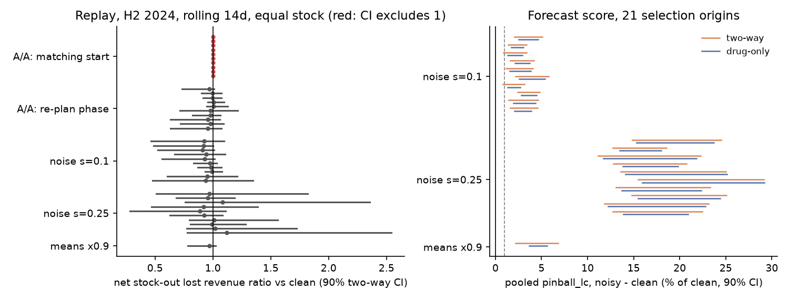
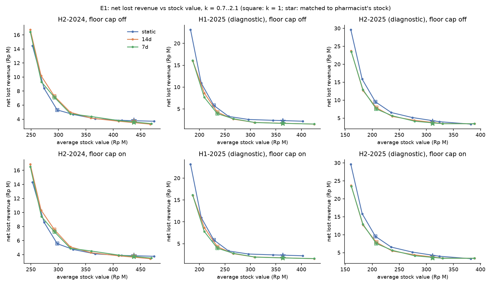
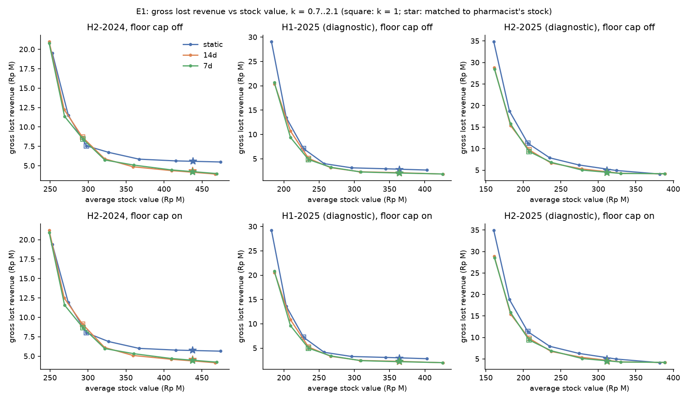
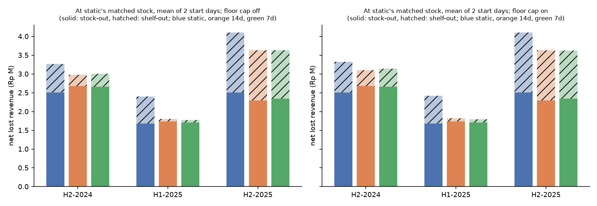

# Experiment notes

Working notes behind [experiments.md](experiments.md). They cover the evaluation
harness and how to use it, the definitions we fixed before running anything, the full
E0 and E1 results, and how the forecast arms were built. The plan these follow is
[experiment-plan.md](experiment-plan.md).

## Evaluation harness: how to use it

Code: `src/irpd/evalx/` (`scorer.py`, `bootstrap.py`, `rolling.py`, `data.py`).
Engine changes it relies on: `replay.schedule`, `replay.simulate_tv` (time-varying
policy, optional floor cap), `replay.losses`; `contest.to_policy(..., rho=)` and
`contest.window_var_factor`; `contest.load_window(..., after_cutoff=True)`.
Tests: `tests/test_evalx_*.py`.

Set a disk cache for windows, facts and bases before heavy runs:

```bash
export IRPD_EVALX_CACHE=data/followup/cache/harness
```

### Score an arm (forecast scores, E0b)

```python
import pandas as pd
from irpd.evalx import score_arm, compare_arms

P = "data/followup/"                                          # run from the repo root
labels = pd.read_parquet(P + "preds/labels.parquet")          # lead_days, price per (origin, drug)
actuals = pd.read_parquet(P + "preds/actuals.parquet")        # weekly truth
daily = pd.read_parquet(P + "harness/daily_truth_selection.parquet")  # exact windows
# For 2025 origins (diagnostic) use harness/daily_truth_full.parquet instead.

ml = score_arm(pd.read_parquet(P + "preds/ml_control.parquet"), actuals, labels, daily=daily)
cur = score_arm(pd.read_parquet(P + "preds/cur_control.parquet"), actuals, labels, daily=daily)
print(ml.summary.loc["all"])          # rows: fast/regular/slow/rare/pooled/all

cmp = compare_arms(ml, cur)            # ml - cur, two-way 90% bootstrap, 1000 draws
print(cmp.query("metric == 'pinball_lc' and subset == 'all'"))
# columns: a, b, diff, rel (= diff / b), lo, hi, rel_lo, rel_hi,
#          non_inferior (hi < 1% of b), superior (hi < 0), worse (lo > 0)
```

The daily truth files are written by `scripts/harness/build_data.py`.

- `daily` is optional but preferred: lead windows rarely end on a Sunday, and without
  it partial weeks are pro-rated from the weekly truth.
- Variance factor (E2): `score_arm(..., rho={"fast": 0.2, "regular": 0.12, "slow": 0.1})`
  scales each window's variance by `1 + rho_tier (w - 1)`, w = window weeks (>= 1).
- Metrics: `pinball_lc` (primary: revenue-weighted pinball 0.95 of the lead + 14-day
  total), `pinball_l`, `crps_lc`, `cov_l`, `cov_lc`, `bias4`, `bias8` (the plan's
  "13-week" bias; only h <= 8 exists), `rwape4`, `wape` (unit, h1-8, uncensored truth),
  `wape_clean` (recorded units, uncensored weeks only). Subsets: `all` (gates),
  `clean`, `censored`. Gate tier set: `pooled` = fast + regular + slow.
- Price comes from `labels` (column `price`, `avg_price`, `price_182d` or
  `avg_price_182d`); a missing lead is 7 days. Note that `labels.parquet` calls it
  `price_avg182`, so the results scripts rename it (see [experiments.md](experiments.md)).
- `irpd.evalx.data.current_preds(origins)` builds the current forecaster in the same
  format (`data/followup/harness/cur_harness.parquet` has it for the 21 selection
  origins).

### Rolling replay (E0a)

```python
from irpd.evalx import ArmSource, CurrentSource, rolling_frontier, compare_replay, first_grid_monday
from irpd.evalx import WINDOWS

start = first_grid_monday(WINDOWS["H2-2024"][0])          # 8 Jul 2024: arms only have G origins
ref = rolling_frontier(ArmSource(P + "preds/cur_control.parquet"), "H2-2024", cadence=14,
                       start=start)                       # matched to the pharmacist's stock
new = rolling_frontier(ArmSource(P + "preds/ml_control.parquet"), "H2-2024", cadence=14,
                       start=start, match_to=ref.matched.summary["stock_value"])
print(new.frontier)        # one row per k in (0.7 .. 2.1): stock_value, lost_gross/net,
                           # gross_out/shelf, net_out/shelf, stockout_days, fill_rate,
                           # cycle_service (k = 1 is the app's real policy)
print(compare_replay(new.matched, ref.matched, "net_out"))   # ratio + two-way 90% interval
```

- `CurrentSource()` computes the current forecaster at any day (no files needed).
- `cadence=None` gives the static (once per window) policy; `floor_cap=True` caps
  floor top-ups at the pharmacist's recent max floor stock; `rho=` passes the E2
  variance factor into the policy.
- Windows: `"H2-2024"` (primary), `"H1-2025"`, `"H2-2025"` (diagnostic). Arm start
  days: `first_grid_monday(...)` and that + 14 days (the plan's "+7" would be off
  the grid; see the definitions below). Arm origins: 8 Jul 2024, 6 Jan 2025, 7 Jul 2025.
- `ArmSource` uses the latest origin at or before each policy day (at most 13 days
  old) and falls back to the current forecaster for drugs the arm lacks
  (`src.fallbacks` counts them per day).
- Replay non-inferiority (from the plan): net stock-out lost revenue ratio new / ref at
  equal stock no more than 1 + margin, averaged over windows and start days. E0 set
  the margin at 7.5%.
- The grid G ends 7 Dec 2025 (51 origins); 14 Dec 2025 is not on the 14-day grid.
- Compute: one matched run is ~20 simulations at ~0.3 s each; bases for the current
  forecaster ~1.3 s per day, cached.

### Bootstrap on anything

```python
from irpd.evalx import two_way, paired_diff
iv = paired_diff(df, "loss_a", "loss_b", den="truth")   # df has origin, drug_code columns
iv.point, iv.lo, iv.hi, iv.excludes_zero()
```

Origins are resampled in blocks of 2 adjacent origins, drugs independently, 1,000
draws; `drugs_only=True` gives the old drug-only interval.

## Definitions fixed before the A/A, power and E1 runs

Written 1 Nov 2026, after the reproduction check (which only reproduces known numbers)
and before any A/A, power or E1 run. These are our readings of the plan.

1. **Net of switching.** Stock-out loss x (1 - stock-out switch rate), shelf-out
   loss x (1 - shelf-out switch rate). Rates: `lost.switch_rates(kind=...)` on spells
   that started by the window's policy day, ingredient rate shrunk to the pooled rate,
   0 for drugs with no alternative in their ingredient group (as `contest.facts`).
   Known before E1: in the H2 2024 reproduction run, one drug (Simvastatin 20mg Berno,
   switch rate 1.0) carries 0.96 of the 2.27 Rp M static shelf-out loss. We saw this
   while checking the harness. The net definition was fixed by the plan, not chosen
   after seeing it; the per-kind rate is the only detail we chose, and it changes little
   (overall rates 0.42 stock-out, 0.49 shelf-out).
2. **Matching tolerance** 0.05% for every comparison. Reproduction checks use 0.5%
   (the project's and the inventory analysis's setting) because the numbers to
   reproduce came from it.
3. **"Equal stock".** The reference (static policy for E1; clean forecaster for power)
   is matched to the pharmacist's average stock value; other arms are matched to the
   reference's achieved stock value.
4. **Start days.** Day 1 of the window and +7 days, for the current forecaster. Arm
   prediction files only have G origins, so for arms the starts are the first G Monday
   and the next one (+14). For a 7-day cadence an arm re-plans on off-grid Mondays from
   the week-old origin.
5. **A/A test.** Primary, literal: the current forecaster (rolling 14-day, H2 2024)
   against itself where the only change is the matching start point (first upper
   bracket of the k bisection: 10 values 1.1 ... 3.0), so k lands at a different point
   inside the 0.05% tolerance. Supplementary: re-plan phase shifted by 1..10 days.
   Both under the two-way bootstrap (14-day periods in blocks of 2 x drugs) on matched
   net stock-out lost revenue. Pass: at most 1 of 10 intervals excludes zero.
6. **Power calibration.** Current forecaster, persistent per-drug mean factor
   lognormal(-s^2/2, s), s = 0.1 and 0.25, 10 seeds each, plus all means x0.9 (one
   deterministic arm; its bootstrap is the only randomness). Variance scales with the
   mean (dispersion kept). Forecast side: 21 selection origins, primary score pooled
   pinball, "flagged worse" = two-way 90% lower bound of (noisy - clean) > 0; NI failure
   = upper bound >= +1%. Replay side: rolling 14-day, H2 2024, day-1 start, matched to
   the clean run's stock value; ratio of net stock-out lost revenue (also net total).
   **Replay NI margin = 80th percentile of |ratio - 1| at s = 0.1**, on net stock-out
   lost revenue (the quantity the replay NI rule is defined on).
7. **13-week bias** is computed on 8-week totals (h <= 8 only) and labelled so.
8. **E1 decision** uses net total lost revenue (stock-out + shelf-out, net of
   switching) at the static policy's matched stock, averaged over the two start days.
   Gross numbers are shown too. 7-day is chosen only if it beats 14-day by > 5% in all
   three windows.
9. **Floor cap** (E1 sensitivity, not pre-registered in the plan): floor top-ups
   capped at the pharmacist's largest end-of-day floor stock in the 182 days before
   the window (at least 1 unit). E1 is reported with and without it; the decision rule
   is applied to both and both verdicts are shown.
10. **Cycle service** = share of orders with no stock-out day from the day after the
    order through its arrival day; orders whose arrival falls after the window drop out.

## E0: harness checks

Date: 1 Nov 2026. Code: `src/irpd/evalx/` plus small additions to `replay.py`
(`schedule`, `simulate_tv`, `losses`) and `contest.py` (`rho` in `to_policy`,
`after_cutoff` in `load_window`). Defaults are unchanged, so the control is
reproducible from the same code. Scripts: `scripts/harness/` (`repro.py`,
`build_data.py`, `e0_checks.py`, `figs.py`). Outputs: `data/followup/harness/`.
Unit tests: `tests/test_evalx_{scorer,bootstrap,rolling}.py` (26 tests, toy cases with
known answers, including CRPS against the E|X-y| - ½E|X-X'| form,
static-equals-rolling-with-one-policy, floor cap, net switching, block bootstrap).

All runs use the current forecaster only (no stored prediction files).

| check | pre-registered pass rule | result | verdict |
|---|---|---|---|
| 1a. Static H2 2024 matched lost revenue | 5.60 Rp M ± 0.5% | 5.6026 (exact, tol 0.5%); 5.6018 at tol 0.05% | pass |
| 1b. Rolling 14-day H2 2024 | the inventory analysis's 4.33 Rp M | 4.3332 (exact, tol 0.5%); 4.3435 at tol 0.05% | pass |
| 2. A/A, matching start point (literal) | ≤ 1 of 10 intervals excludes 0 | 10 of 10 exclude 0; ratios 0.9991-1.0002 | **fail** (see below) |
| 2'. A/A, re-plan phase +1..10 days (supplementary) | same | 0 of 10 (drug-only: 2 of 10) | pass |
| 3. Replay NI margin | 80th pct of \|ratio-1\| at σ = 0.1 | **7.5%** (net stock-out lost revenue) | set |

### 1. Reproduction (H2 2024, policy day 30 Jun 2024)

`repro.json`. Through the project's own path (`replay.simulate` +
`match_stock_value`, tol 0.5%) and through the harness (`simulate_tv`, same bisection),
the static policy gives 5,602,631 Rp at k = 1.875, identical to the project and the
inventory analysis. The rolling 14-day replay gives 4,333,227 Rp at k = 1.922, identical
to the inventory analysis. `simulate_tv` with one policy equals `replay.simulate` cell
for cell.

At the harness's 0.05% tolerance the numbers move by -0.02% (static) and +0.24%
(rolling). The 0.24% is the size of the matching jitter the inventory analysis warned
about.

**Net of switching changes the picture.** In the static run, 0.96 of the 2.27 Rp M
shelf-out loss is one drug (Simvastatin 20mg Berno: its floor sales rate on 30 Jun was
0.71/day against 13.8/day demand in H2 2024) with switch rate 1.0, so its net loss is 0.
Net lost revenue is 3.82 (static) vs 3.68 (rolling), not 5.60 vs 4.34. See E1.

### 2. A/A test

`e0_replay_checks.csv`; figure [power_calibration.png](fig/harness/power_calibration.png) (left).

- **Literal A/A (matching start point) fails: 10 of 10 two-way intervals exclude zero.**
  The arms differ only by where the k bisection lands inside the 0.05% tolerance
  (k 1.9195-1.9214). The lost-revenue ratio is 0.9991-1.0002: at most 0.09%. The
  interval is "significant" because a slightly larger k lowers loss for nearly every
  drug at once, so the paired difference has almost no spread. This is a real property
  of paired replay comparisons, not a bug: any systematic stock difference, however
  tiny, can exclude zero. **Consequence: never use "interval excludes zero" as a replay
  decision rule. Use the non-inferiority margin (below), which is 80x larger than this
  effect.**
- **Supplementary A/A (re-plan phase shifted 1-10 days): 0 of 10 exclude zero** under
  the two-way bootstrap (2 of 10 under drug-only). But the point ratios range from
  0.955 to 1.007: shifting the re-plan days alone moves net stock-out loss by up to
  4.5%. Single-run comparisons like those in the inventory analysis sit inside this
  noise.

### 3. Power calibration

Persistent per-drug mean noise (lognormal, mean 1), 10 seeds each, plus all means x0.9.

**Forecast scores (21 selection origins, 7 Jan - 13 Oct 2024).** `e0_forecast_power.csv`,
figure right. Primary score: pooled (fast + regular + slow) revenue-weighted
pinball(0.95) of the lead + 14-day total.

| arm | pooled pinball change | flagged worse, two-way | flagged worse, drug-only | fails NI (+1%), two-way |
|---|---|---|---|---|
| σ = 0.1 (≈ ML-vs-current WAPE gap) | +2.9% | 10/10 | 10/10 | 10/10 |
| σ = 0.25 | +18% | 10/10 | 10/10 | 10/10 |
| all means x0.9 | +4.6% | yes | yes | yes |

By tier at σ = 0.1 (two-way): fast 9/10, regular 8/10, slow 2/10 flagged worse.

So the new primary score has **good power**: it catches σ = 0.1 noise every time,
where the inventory analysis's matched-replay test caught it 1 time in 10. Two-way
intervals are only about 10-15% wider than drug-only ones here (pooled width 4.3 vs 3.9
points), not the 1.5-2x the plan expected. Origin-to-origin variation in pinball
differences is small because the noise is persistent per drug.

Current forecaster on these origins (`e0_current_selection_scores.csv`), all
windows: pooled pinball_lc 0.0797, CRPS 0.309, p95 coverage lead 0.958 / lead + cycle
0.936, 4-week bias 1.07 (on uncensored truth), 8-week bias 1.07, revenue-weighted
4-week WAPE 0.39, unit WAPE 0.51 (0.47 on clean weeks, recorded units).

**Replay at equal stock (H2 2024, rolling 14-day, day-1 start).** Ratio of net
stock-out lost revenue, noisy / clean, both at the clean run's stock.

| arm | mean ratio | range | 80th pct \|ratio-1\| | intervals excluding 1 (two-way / drug-only) |
|---|---|---|---|---|
| σ = 0.1 | 0.947 | 0.913-0.993 | **0.075** | 0/10 / 4/10 |
| σ = 0.25 | 0.988 | 0.887-1.120 | 0.088 | 0/10 / 1/10 |
| x0.9 | 0.971 | - | 0.029 | 0 / 0 |

- **Replay NI margin = 7.5%** (rule: 80th percentile at σ = 0.1). It is under 10%, so by
  the plan's wording the replay is not "a guard for gross failures only". But read
  the next two points before relying on it.
- **Noise made the replay look better, not worse.** σ = 0.1 noise lowered net stock-out
  loss in all 10 seeds (mean -5%), and the x0.9 arm too (-3%). A clearly worse forecast
  (pinball +3% to +18%) does not lose in the replay at equal stock. Matching re-spreads
  stock, and with a 6-month window dominated by a few drugs the outcome is driven by
  where stock lands, not by forecast quality. The replay cannot rank forecasters; it
  can only flag large regressions, and even that is not shown here.
- **Two-way replay intervals are very wide**: mean width 0.70 in ratio at σ = 0.1
  (drug-only 0.16), because a half-year holds only 13 two-week periods (7 blocks) and
  loss is concentrated in few drug-periods. No replay difference under about ±30% will
  be called significant.



### What this means for later experiments

1. Gate forecast changes on the scorer (pinball_lc and friends). It has power.
2. Use the replay for non-inferiority only, margin 7.5% on net stock-out lost revenue,
   averaged over windows and start days, and report it as weak evidence: in calibration
   it moved the wrong way for worse forecasts.
3. Report replay results at k = 1 too (cycle service, fill rate, stock value): that is
   the policy the app shows, and matching hides level bias.
4. Always show net and gross lost revenue. Gross is dominated by a few high-switch drugs.

### Caveats

- One window (H2 2024) for the replay calibration, as pre-registered.
- The literal A/A failed; the supplementary one passed. We chose the supplementary
  design before running, but the pass/fail rule was written for the literal one.
- Two-way intervals for the replay use 14-day periods as "origins"; with 13 periods per
  half-year, they are coarse.
- The daily truth for selection origins is computed as of 8 Dec 2024
  (`daily_truth_selection.parquet`); `daily_truth_full.parquet` (as of 31 Dec 2025) is
  for 2025 diagnostics.

## E1: re-plan cadence

Date: 1 Nov 2026. Script `scripts/replan/e1.py`; outputs in `data/followup/replan/`:
`e1_matched.csv` (matched runs, with two-way bootstrap ratios), `e1_frontier.csv`
(k = 0.7..2.1), `e1_runs.pkl`. Definitions: see above.

Setup: current forecaster, plain policy (service 0.95, 14-day cycle, floor 2-7 days).
Static = one policy on the day before the window; 14d / 7d = re-planned every 14 / 7
days from data up to each re-plan day. Static is matched to the pharmacist's average
stock value (tol 0.05%); 14d and 7d are matched to the static run's stock. Demand is
the uncensored estimate. Windows: H2 2024 (primary), H1 2025 and H2 2025
(diagnostic). Two start days each (day 1, day 8); numbers below are means of the two.

### Decision

**Pre-registered rule: adopt 14-day if net lost revenue falls ≥ 15% in H2 2024 and
falls in both 2025 windows. Not met: H2 2024 falls 9.9% (7.5% with the floor cap).**
The direction is right in every window, start day and cap setting (ratios 0.75-0.98),
but the 15% bar is missed and no interval excludes 1. The 23% gain found in the
inventory analysis is real in gross terms (22% here) but most of it is shelf-out loss
on drugs whose lost demand switches to a sibling brand.

**7-day vs 14-day: not chosen** (7d/14d net ratio 1.02 in H2 2024, 0.98 in H1 2025,
1.00 in H2 2025; it needed < 0.95 in all three).

Practical reading: re-planning every 14 days is never worse and is a sensible
default for the evaluation (it lets short-horizon forecast quality matter at all), but
the pre-registered evidence for "≥ 15% less lost revenue" is not there. We adopted the
14-day rolling replay as the evaluation harness's default on design grounds (the
app's real process re-orders weekly to every two weeks), and make no claim of a
measured gain for the app. The rule itself says "not adopted".

### Main table (no floor cap; mean of two start days; Rp M at equal stock)

| window | cadence | net lost | net stock-out | net shelf-out | gross lost | gross stock-out | gross shelf-out | net ratio vs static |
|---|---|---|---|---|---|---|---|---|
| H2 2024 | static | 3.27 | 2.51 | 0.76 | 4.47 | 2.72 | 1.75 | - |
| | 14d | 2.98 | 2.68 | 0.29 | 3.48 | 2.92 | 0.56 | **0.90** |
| | 7d | 3.01 | 2.66 | 0.35 | 3.54 | 2.90 | 0.64 | 0.92 |
| H1 2025 (diag.) | static | 2.40 | 1.68 | 0.72 | 2.95 | 2.01 | 0.94 | - |
| | 14d | 1.80 | 1.73 | 0.07 | 2.20 | 2.12 | 0.08 | 0.75 |
| | 7d | 1.77 | 1.71 | 0.07 | 2.15 | 2.08 | 0.07 | 0.74 |
| H2 2025 (diag.) | static | 4.10 | 2.51 | 1.59 | 5.01 | 3.13 | 1.87 | - |
| | 14d | 3.63 | 2.30 | 1.33 | 4.47 | 2.91 | 1.56 | 0.89 |
| | 7d | 3.63 | 2.35 | 1.28 | 4.47 | 2.98 | 1.49 | 0.88 |

Per start day, H2 2024 14d/static net ratio: 0.964 (day 1, 90% CI 0.49-1.36) and
0.837 (day 8, CI 0.35-1.19). Gross: 0.775 and 0.784.

What moves:

- **Almost all of the gain is the floor refresh.** Shelf-out loss drops 60-90%; the
  stock-out part is flat or slightly worse in 2024-H1 2025 (net stock-out ratio 1.06
  in H2 2024, 1.03 in H1 2025) and better only in H2 2025 (0.92).
- **The static policy is fragile to its start day.** Moving the H2 2024 start from
  1 Jul to 8 Jul changes static gross loss from 5.60 to 3.33 Rp M, because one drug's
  floor sales rate on the policy day was stale (Simvastatin 20mg Berno). Any single
  static run is a lottery on a few facts. That alone argues for rolling evaluation.
- Re-planning does not change stock-out days much (H2 2024: 539 → 541 on day 1).







### Floor capacity cap

The plain simulation has unlimited shelf space. As a proxy, floor top-ups were capped at
each drug's largest end-of-day floor stock in the 182 days before the window (at least
1). The decision rule was applied with and without it.

| window | net ratio 14d/static, no cap | with cap | gross ratio, no cap | with cap |
|---|---|---|---|---|
| H2 2024 | 0.901 | 0.925 | 0.779 | 0.804 |
| H1 2025 | 0.751 | 0.753 | 0.746 | 0.752 |
| H2 2025 | 0.885 | 0.885 | 0.893 | 0.895 |

The cap raises shelf-out loss a little on both sides and trims the H2 2024 gain by about
2.5 points. It rarely binds, because the pharmacist's historical maximum is generous.
The verdict is the same either way (fails the 15% bar). A tighter, real shelf-space limit
would shrink the gain further; we have no data on actual shelf space.

### At k = 1 (the app's unmatched policy; day-1 start, no cap)

| window | cadence | stock value | net lost | fill rate | cycle service |
|---|---|---|---|---|---|
| H2 2024 | static | 297.8 | 5.31 | 0.926 | 0.933 |
| | 14d | 292.5 | 7.29 | 0.931 | 0.920 |
| H1 2025 | static | 228.1 | 5.82 | 0.926 | 0.922 |
| | 14d | 235.1 | 4.27 | 0.936 | 0.926 |
| H2 2025 | static | 205.9 | 9.54 | 0.943 | 0.900 |
| | 14d | 207.5 | 7.91 | 0.948 | 0.906 |

At k = 1 the policy holds 63-68% of the pharmacist's stock value, and achieved
lead-time cycle service is 0.90-0.93 against the 0.95 target, in line with the known
under-coverage of lead-time totals (E2 targets this). At k = 1, 14-day re-planning
loses more than static in H2 2024 and less in both 2025 windows. At the matched scale
(k ≈ 1.7-1.9) cycle service is 0.955-0.977.

### Caveats

- Current forecaster only. A forecaster that reacts faster could gain more from
  re-planning (the oracle in the inventory analysis).
- Two-way intervals are wide (see E0); no E1 ratio interval excludes 1.
- 2025 windows are diagnostic. H2 2025 uses the full warehouse and includes the store
  change and the August stock count.
- Net of switching assumes the sibling brand is in stock; when it is not, the true
  loss is between net and gross.
- The floor cap is a proxy, not measured shelf space.

## Forecast arms

How the stored predictions in `data/followup/preds/` were built. Runner:
`scripts/arms/run_arms.py` (it retrains the ML at every origin, so it is slow; see
the table below).

### Choices fixed before any arm was scored

These were recorded before any prediction file existed.

1. **ML Eid arm also switches `c_eid_uplift` to store units (unshrunk).** The
   plan lists dates, cap and day counts for the ML, and the unit profile for
   the current forecaster only. The diagnosis of the late 2025 peak points at
   two causes: the single Thursday distance `c_eid_days`, and an uplift built
   on store *lines*. Lines rate the week after Eid above the week before; units
   do the opposite, as the 2025 sales did. At the 2 Mar 2025 origin the lines
   factor for the weeks of 24 and 31 Mar is 1.192 vs 1.210 (wrong order); the
   units factor is 1.341 vs 1.251 (right order). Leaving the lines uplift in
   the ML would leave one of the two causes in place. So `ml_eid` = dates +
   cap 45 + day counts + units uplift. This was a design check on the factor
   alone, not a look at any forecast score.
2. **"Closed days" counts Eid day only.** The store sold nothing on Eid day in
   2023, 2024 and 2025, and traded normally on every cuti bersama day (no
   zero-sales day besides Eid day, 1 Jan 2024/2025 and 9-10 Oct 2025). So
   `c_eid_closed` counts the Eid day. A cuti bersama list would count open
   days as closed.
3. **Unit Eid profile is unshrunk** (`EID_UNIT_SHRINK = 1.0`). The 0.6 shrink
   was set to correct lines overstating the uplift on units; with units it has
   no stated reason. The diagnosis suggested "unit-based, unshrunk". Not tuned.
4. **E4 shelf-out handling = flag, not scaling.** Weeks dropped only for
   shelf-outs (4+ shelf-out days, no total stock-out) are kept with recorded
   units, and every training row gets `d_tgt_shelf`, its target week's
   shelf-out days. Prediction rows get 0, so the forecast is demand with the
   shelf stocked. Rows before the stock ledger have it missing.
5. **E4 imputation is the day-by-day form of the `lost.py` estimator**, not
   `lost.uncensored_units` itself. `lost.uncensor` spreads a spell's total
   lost units over its days, and that total uses recorded sales on later days
   of the spell, so a week's value can depend on days after the week (a small
   leak for training). The day-by-day form (rate before the spell x the day's
   traffic) uses nothing after the day. Weeks with an out day that can't be
   estimated (no baseline, or past the 28 counted days) stay NaN. It is gross:
   nothing is taken off alternatives. `actuals.parquet` carries both the
   `lost.spells` version (`uncensored_units`) and this one
   (`uncensored_units_daily`).
6. **ML variance stays the baseline NB recipe for every ML arm** (mean x the
   drug's dispersion on lines-Eid-adjusted history, as frozen), so arms differ
   only in the mean. E2 (variance factor) is tested in scoring.
7. **Segment label details** (the plan leaves them open): sporadic's zero
   share is over observed weeks (after first sale, uncensored) of the last 52,
   and needs 13 observed weeks, otherwise only the rare-tier rule applies;
   censored = 20%+ of the last 26 weeks (after first sale, ledger-covered) with
   a total stock-out day, shelf-outs not counted.
8. **Drug sets.** ML arms cover the panel's active rows (a sale in the 52
   weeks before the origin), with a `scored` flag (sale in the last 13 weeks,
   the project's scored set). Current and TSB arms cover every drug with a sale
   by the origin, as `forecast.forecast` does. Scoring inner-joins on the drugs
   it compares.
9. **Current forecaster censoring.** `cur_*` use `forecast.load_history`
   (total stock-out weeks dropped), as the app does. The project's `eval-old`
   predictions ran the same methods through the ML history, which also drops
   4+ shelf-out-day weeks, so they differ slightly from `cur_control`.
10. **Grid end.** The plan's grid is "7 Jan 2024 + 14k, up to and including
    14 Dec 2025 (52 origins)". 14 Dec 2025 is not on that grid (7 Dec is k=50,
    21 Dec is k=51). We kept the formula and the count: 52 origins, 7 Jan 2024 to
    21 Dec 2025. The last origin has one target week with data (22-28 Dec);
    7 Dec has three. Scoring can drop 21 Dec to get 51.

Eid dates: 2026 = Fri 20 Mar 2026 and 2027 = Wed 10 Mar 2027 (1 Syawal 1447
and 1448 H), expected dates. Kemenag fixes each at its isbat, and the government
calendar can differ from Muhammadiyah's by a day; confirm before E7. Within this
data (to 31 Dec 2025) they only change `c_eid_days` for target weeks from late
Sep 2025 (nearest Eid becomes 2026), and only in the `eid_list="full"` arms.

### What changed in `src/irpd`

- `forecast.py`
  - `EID`: adds 20 Mar 2026 and 10 Mar 2027. New `EID_LEGACY` (the three
    frozen dates), read only by the ML's default `c_eid_days`.
  - `load_history` / `_slice`: also return and cut `store_units` (store units
    per day).
  - `eid_factors(lines, shrink=EID_SHRINK)`: shrink is now a parameter.
  - `eid_profile(hist, profile)`: 'lines' (shipped: lines, shrink 0.6) or
    'units' (store units, `EID_UNIT_SHRINK` = 1.0).
  - `predict(..., eid="lines")`: picks the profile. Default unchanged.
  - `tsb(hist, horizon, alpha_p=0.15, alpha_d=0.10)`: weekly mean, var
    (mean x dispersion), rate. Reuses `_tsb`.
- `ml/history.py`: `load` adds `stockout` (total stock-out weeks, before
  shelf-outs join `out`); `cut` cuts `stockout` and `store_units`.
- `ml/schema.py`: `PanelContext.options` (dict, default empty = frozen).
  Not in `MLConfig`, so config hash 36ad7c615b96 is unchanged.
- `ml/panel.py`: `context(..., options=None)` passes it through.
- `ml/features/calendar.py`: options `eid_list` ('legacy'|'full'),
  `eid_days_cap` (None|days), `eid_day_counts` (bool), `eid_uplift`
  ('lines'|'units'); new `capped_eid_days`, `day_counts`, `DAY_BANDS`.
  New columns when on: `c_eid_pre7`, `c_eid_closed`, `c_eid_post7`,
  `c_eid_post14`.
- `ml/censor.py` (new): `stockout_estimate(ctx)`, `censor_aware(panel, ctx,
  target='impute'|'mask', shelf='flag'|'mask')`, `for_prediction(rows)`,
  `SHELF_FLAG = "d_tgt_shelf"`.
- `ml/segments.py` (new): `labels(h_cut, tier)` for fading / sporadic / new /
  censored at an origin.
- Tests: `tests/test_forecast_experiments.py` (13 tests): Eid list
  covers 2026-27 and keeps the frozen list; `c_eid_days` stays in the
  training range after Sep 2025 with the full list (plan E3 check c);
  the cap; day counts on known weeks (and they sum to the days within
  -7..+14 for 220 weeks); calendar defaults equal the frozen features; the
  units vs lines profile; TSB on a toy series (including a censored week);
  segment labels on a toy history; censoring-aware targets: rows restored,
  switches off = no change, **truncation** (data cut at the origin gives the
  same training targets and shelf flags) and **future perturbation** (later
  data changed, same training targets), on the synthetic warehouse.

### Arms produced

52 origins each, 7 Jan 2024 to 21 Dec 2025 (see item 10).

| arm | rows | drugs per origin | fit time |
|---|---|---|---|
| ml_control | 959,880 | ~17.9-19.0k rows (active 52 wk) | 26 min (10 threads) |
| ml_eid | 959,880 | same | 38 min (3 threads, 4 jobs in parallel) |
| ml_censor | 959,880 | same | 37 min (same) |
| ml_eid_censor | 959,880 | same | 40 min (same) |
| ml_eid_offset (post hoc) | 959,880 | same | 18 min |
| cur_control, cur_eid, tsb | 1,106,232 each | every drug sold by the origin | 1 min for all three |

Plus `labels.parquet` (138,279 rows: origin x drug with a sale by it) and
`actuals.parquet` (383,320 drug-weeks, 2 Jan 2023 to 22 Dec 2025). Each has a
`.json` with flags, config, origins and runtime. ML files carry extra
columns `scored` and `mean_seed0..2`; tsb carries `stop_flag`; cur carries
`method`. One shared panel build: 54 s (2.67M rows x 48 columns).

### Validation

- **ml_control vs the frozen eval predictions**
  (`data/ml/eval/predictions/36ad7c615b96_*`, 9 origins 5 Jan to 27 Apr 2025,
  15.4-16.0k scored rows each, all matched): **max abs difference 0.0** for
  the mean and the variance at every origin (bit-identical). So one panel built
  on the full warehouse to 28 Dec 2025, read through as-of connections,
  reproduces the frozen system.

  | origin | rows | matched | max abs diff (mean) | sum ratio | max abs diff (var) |
  |---|---|---|---|---|---|
  | 2025-01-05 | 15,440 | 15,440 | 0.0 | 1.0 | 0.0 |
  | 2025-01-19 | 15,504 | 15,504 | 0.0 | 1.0 | 0.0 |
  | 2025-02-02 | 15,568 | 15,568 | 0.0 | 1.0 | 0.0 |
  | 2025-02-16 | 15,608 | 15,608 | 0.0 | 1.0 | 0.0 |
  | 2025-03-02 | 15,656 | 15,656 | 0.0 | 1.0 | 0.0 |
  | 2025-03-16 | 15,776 | 15,776 | 0.0 | 1.0 | 0.0 |
  | 2025-03-30 | 15,896 | 15,896 | 0.0 | 1.0 | 0.0 |
  | 2025-04-13 | 15,920 | 15,920 | 0.0 | 1.0 | 0.0 |
  | 2025-04-27 | 16,024 | 16,024 | 0.0 | 1.0 | 0.0 |

- **cur_control vs `forecast.forecast`** on an as-of connection (17 Mar 2024,
  2 Mar 2025, 23 Nov 2025): identical (0.0). Against the project's `eval-old`
  files it differs on ~22% of rows, totals 0.5-0.9% lower, because eval-old
  ran through the ML history, which also drops 4+ shelf-out-day weeks (item 9).
- **E4 direction check** (forecast totals only, selection origins):
  ml_censor / ml_control = 1.06 fast, 1.07 regular, 1.10 slow on drugs
  labelled censored, 1.005-1.04 on the rest. Rare censored drugs go down
  (0.95). The panel gets 141k of 431k censored training rows back. 80% of
  censored drug-weeks in `actuals` can't be estimated day by day: most are
  deep in long spells (past 28 days), where `lost.py` also stops counting.

### Eid placement check (structural, not a score)

Forecast peak week of fast + regular + slow units, ML drug set. The number after each
week is peak-week forecast / actual peak-week units.

| origin | actual | ml_control | ml_eid | ml_eid_offset (post hoc) | ml_eid_censor | cur_control | cur_eid |
|---|---|---|---|---|---|---|---|
| 2024-02-18 | 2024-04-08 | 04-08 1.07 | 04-08 1.16 | 04-08 1.11 | 04-08 1.17 | 04-08 1.08 | 04-08 1.14 |
| 2024-03-03 | 2024-04-08 | 04-08 1.08 | 04-08 1.17 | 04-08 1.13 | 04-08 1.19 | 04-08 1.09 | 04-08 1.15 |
| 2024-03-17 | 2024-04-08 | 04-08 1.03 | 04-08 1.16 | 04-08 1.11 | 04-08 1.18 | 04-08 1.10 | 04-08 1.17 |
| 2024-03-31 | 2024-04-08 | 04-08 1.00 | 04-08 1.12 | 04-08 1.12 | 04-08 1.14 | 04-08 1.10 | 04-08 1.17 |
| 2025-02-02 | 2025-03-24 | 03-24 0.86 | 03-24 0.84 | 03-24 0.99 | 03-24 0.84 | 03-24 0.89 | 03-24 1.00 |
| 2025-02-16 | 2025-03-24 | 03-31 1.00 | 03-31 1.16 | 03-24 1.08 | 03-31 1.15 | 03-31 0.92 | 03-24 1.02 |
| 2025-03-02 | 2025-03-24 | 03-31 0.95 | 03-31 1.11 | 03-24 1.02 | 03-31 1.11 | 03-31 0.93 | 03-24 1.03 |
| 2025-03-16 | 2025-03-24 | 03-31 0.94 | 03-31 1.07 | 03-24 1.01 | 03-31 1.08 | 03-31 0.91 | 03-24 1.01 |

(These ratios use the ML drug set and differ slightly from the store-level table in
[experiments.md](experiments.md), which uses the common scoring set.)

- 2024 origins (18 Feb, 3 Mar, 17 Mar, 31 Mar): every arm puts the peak in
  the right week (8 Apr). The Eid arms overshoot it more: peak-week forecast
  / actual 1.11-1.19 vs 1.00-1.10 for the controls. With one past Eid
  (2023) the unshrunk unit profile is too high for 2024.
- 2025 origins whose window holds both 24 and 31 Mar (16 Feb, 2 Mar, 16 Mar):
  - cur_control, ml_control: wrong week (31 Mar) at 3 of 3.
  - **cur_eid: right at 3 of 3** (peak / actual 1.01-1.03).
  - **ml_eid and ml_eid_censor: still wrong at 3 of 3**, and higher than
    control (1.07-1.16).
  - ml_eid_offset (post hoc): right at 3 of 3 (1.01-1.08).

Why ml_eid fails: no training week ever had 7 pre-Eid days. In 2023 and
2024 the high weeks were the ones with many post-Eid days (2023: +2..+8;
2024: -2..+4). And the 2023 training rows have no uplift at all (no earlier
Eid to learn it from). A tree can't extrapolate to a new split of days, so
the day counts don't fix it. Taking the store-level factor out of the tree
(divide targets by it, multiply forecasts by it, factors as known at each
fit origin) does. **This arm was designed after seeing the 2025 placement,
which is diagnostic data, so it is post hoc.** On the 2024 selection origins
all arms place the peak right, so the selection set can't tell them apart.

### Concerns at the time

- ml_eid as pre-registered was likely to fail E3's placement rule on 2025 (it did).
  ml_eid_offset passes it but is post hoc; its overshoot on 2024 (1.11-1.13)
  shares the unshrunk-profile problem. Eid 2026 (E7) is the only clean test.
- The unshrunk unit profile overshoots Eid 2024 by 11-17% at store level
  for both forecasters. A shrink below 1 might be better, but choosing it
  would need the 2024 Eid origins, and that is the test.
- Day-level E4 estimates cover few censored weeks (long spells excluded),
  so E4's effect is limited to short outages.
- Origins after 30 Jun 2025 use the full warehouse (diagnostic, as the plan
  allows). The last origin (21 Dec 2025) has one target week of data.
