# Forecast experiments E0-E6: results

Date: 1 Nov 2026. These are the experiments we ran after the diagnostic work, to test
the fixes it pointed to. No model was trained for this report; every forecast comes
from the stored prediction files in `data/followup/preds/` (built by
`scripts/arms/run_arms.py`). The decision rules are the ones pre-registered in
[experiment-plan.md](experiment-plan.md), applied as written. Selection origins (21 two-weekly Sundays, 7 Jan - 13 Oct 2024)
decide. 2025 has already been inspected, so every 2025 number is **diagnostic**: it can
show a regression, but it can't prove a gain. Anything marked **exploratory** or
**post hoc** was not pre-registered.

## Outcome in short

**No change passed its pre-registered rule.** The harness (E0) works and reproduces the
known numbers. Each fix (E1-E5) failed at least one condition of its rule. The default
forecaster question (E6) is not settled by the rule either.

| exp. | change | verdict | the condition that failed |
|---|---|---|---|
| E0 | evaluation harness | **pass** (reproduction); replay NI margin set at 7.5% | literal A/A check failed, for a known and harmless reason |
| E1 | re-plan (s, S) and floor every 14 days | **not adopted** | net lost revenue fell 10% in H2 2024; the bar was 15% |
| E2 | variance factor 1 + ρ(w − 1) | **not adopted** (ML and current) | over-covers fast drugs on Jul-Oct 2024 (0.975 / 0.983); pinball +2-3% |
| E3 | Eid repair, current forecaster | **not adopted** | right peak week at 8 of 8 origins, but Eid-week store error rose in 2024 (0.094 vs 0.053) |
| E3 | Eid repair, ML | **not adopted** | still puts the 2025 peak a week late (1 of 4 right); pinball not non-inferior |
| E3 | ML Eid offset (**post hoc**) | not eligible | placed 2025 right (4 of 4), but was designed after seeing 2025, and fails the 2024 error and pinball checks |
| E4 | censoring-aware ML targets | **not adopted** | censored-segment bias 2.28 (band 0.95-1.05); slow tier moves away from 1 |
| E5 | fading → TSB | **not adopted** | frees 0.8% of stock (needed 5%), +4.6 stock-out days per drug (max 2) |
| E5 | sporadic min-stock | **not adopted** | frees stock (5.6% ML, 27.5% current), but +5-6 stock-out days per drug |
| E6 | ML as default | **rule not met** | pooled pinball is better (−5.1%, CI −7.9% to −2.5%), but fast tier can't be shown non-inferior and regular bias is 1.10 |
| E6 | ensemble instead of ML | **not adopted** | −0.3% vs ML, CI up to +0.8% |

What this means:

- **ML is the better forecaster on the primary score**, on the gate set and in 2025. Its
  pooled pinball is 5% lower than current, and the interval excludes zero. The gain
  comes from the slow and rare tiers. In fast and regular drugs the two can't be told
  apart. The replay sees no difference (net stock-out ratio 1.00). By the rule, ML
  doesn't become the default, so the owner's choice stands, with both shown.
- **Two findings change how the rules should be read.** First, the "uncensored demand"
  truth stops counting lost sales after 28 days of a stock-out. So windows where a drug
  is out all month have near-zero truth. That breaks the bias gates for censored and
  fading drugs: bias 2-8 on those segments is a truth artefact, not a forecast defect
  (E4, E5). Second, the replay only covers the 857 fast and regular drugs. E5's rules
  touch just 4 sporadic and 43 fading drugs there, so the replay can barely test them.
- **The defects are real, but the fixes as built don't clear the bar.** The current
  forecaster's unit-based Eid profile fixes the late 2025 peak, but it overshoots
  Eid 2024 by 11-14%. The ML day-count features don't fix the late peak. The variance
  factor helps 2025, but over-covers in quiet months when ρ is fitted on a half-year
  that includes Eid.
- The plan says the Eid 2026/2027 dates and the 45-day cap on `c_eid_days` ship
  regardless, as correctness fixes. Check (c) passes (the unit test below).

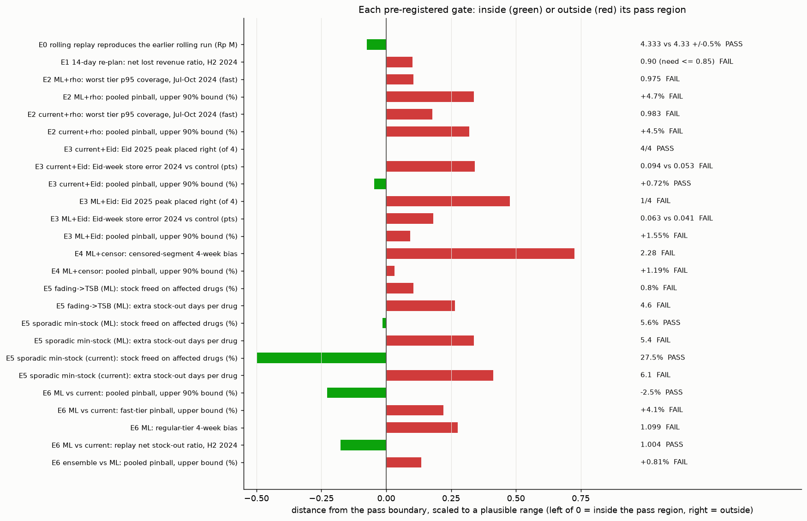

*Each row is one gate condition. Bars left of zero are inside the pass region, bars to
the right are outside. Scales differ by row, so compare only the sign and rough size.*

### Scoring set-up (applies to E2-E6)

Scores come from `irpd.evalx.score_arm`. The primary score is revenue-weighted pinball
loss at 0.95 of each drug's lead + 14-day total. Truth is daily uncensored demand.
Intervals are 90% two-way bootstrap (origin blocks of 2 × drugs, 1,000 draws). Every arm
is scored on the same set of (origin, drug) pairs: those present in both `ml_control`
and `cur_control`, i.e. the ML's active-52-week drugs. That is 47,542 windows on the
selection origins and about 62,000 on the 24 diagnostic 2025 origins (5 Jan - 23 Nov
2025). "Pooled" means fast + regular + slow.

**Harness workaround.** `labels.parquet` names the 182-day price `price_avg182`. The
scorer looks for `price` / `avg_price` and silently uses 0 when neither is found, which
would zero every revenue-weighted score. The results scripts rename the column
(`scripts/results/common.py`). No harness code was changed.

---

## E0. Evaluation harness (pre-registered)

**What changed.** `src/irpd/evalx/` (`scorer.py`, `bootstrap.py`, `rolling.py`,
`data.py`), plus `replay.schedule`, `replay.simulate_tv` and `replay.losses` in
`src/irpd/replay.py`, and `rho` / `window_var_factor` in `src/irpd/contest.py`.
Full write-up: [experiment-notes.md](experiment-notes.md#e0-harness-checks).

**Rule.** Static H2 2024 reproduces 5.60 Rp M within 0.5%. Rolling reproduces 4.33 Rp M.
A/A test: at most 1 of 10 intervals excludes zero. The replay NI margin is the 80th
percentile of |ratio − 1| at σ = 0.1.

| check | result | verdict |
|---|---|---|
| static H2 2024 lost revenue | 5.6026 Rp M | pass |
| rolling 14-day H2 2024 | 4.3332 Rp M | pass |
| A/A, matching start point (literal) | 10 of 10 exclude 0 (ratios 0.9991-1.0002) | fail: tiny systematic stock differences always "significant" |
| A/A, re-plan phase shift (supplementary) | 0 of 10 | pass |
| replay NI margin | 7.5% | set |
| power of the forecast score | catches σ = 0.1 noise 10 of 10 times | good |
| power of the replay | σ = 0.1 noise *lowered* loss (mean −5%) | the replay can't rank forecasters |

**Verdict.** The harness is usable. The forecast scores gate; the replay is a weak guard
only. "Interval excludes zero" must never be used as a replay rule.

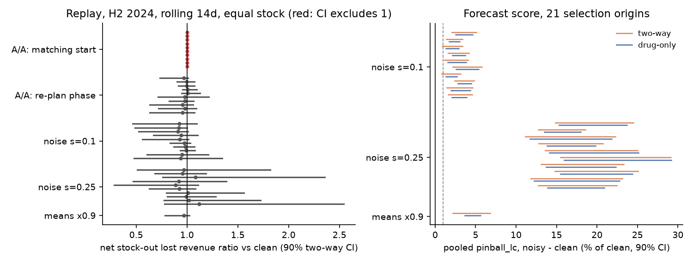

## E1. Re-plan cadence (pre-registered)

**What changed.** `rolling_frontier(..., cadence=14)` in `src/irpd/evalx/rolling.py`.
Policy re-planned every 14 (or 7) days. Full write-up:
[experiment-notes.md](experiment-notes.md#e1-re-plan-cadence).

**Rule.** Adopt 14-day if net lost revenue at the static policy's matched stock falls
≥ 15% in H2 2024 and falls in both 2025 windows.

| window | net lost, static (Rp M) | net lost, 14-day | ratio | gross ratio |
|---|---|---|---|---|
| H2 2024 | 3.27 | 2.98 | **0.90** | 0.78 |
| H1 2025 (diag.) | 2.40 | 1.80 | 0.75 | 0.75 |
| H2 2025 (diag.) | 4.10 | 3.63 | 0.89 | 0.89 |

**Verdict: not adopted by the rule.** The direction is right in every window, but the
H2 2024 gain is 10%, not 15%. Almost all of it is the floor refresh (shelf-out loss), and
much of that is on drugs whose lost demand switches to a sibling brand. 7-day adds
nothing over 14-day. The 14-day rolling replay is still used below as the evaluation
harness's mode, on design grounds.

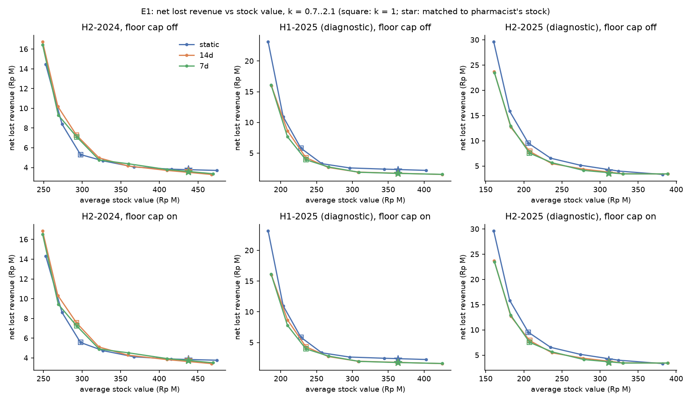

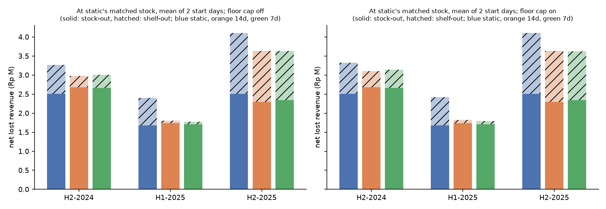

## E2. Lead-time variance factor (pre-registered)

**What changed.** `contest.window_var_factor` and the `rho=` argument of `score_arm` /
`to_policy` (`src/irpd/contest.py`, `src/irpd/evalx/scorer.py`). The weekly
NB variance of a w-week window is multiplied by 1 + ρ_tier (w − 1).

**How ρ was fitted.** ρ is the lag-1 correlation of standardised weekly errors,
z = (y − mean) / √max(var, mean), between adjacent horizons. It was fitted per tier on
the 13 selection origins before 1 Jul 2024, as in the exploratory check. The Eid-split
arm fits a separate ρ for weeks within −30..+28 days of Eid. A scored window uses the
Eid ρ if it overlaps that band (our operational choice; the plan doesn't say how to
classify a multi-week window).

| ρ (fitted on Jan-Jun 2024) | fast | regular | slow | rare |
|---|---|---|---|---|
| ML | 0.377 | 0.152 | 0.147 | 0.202 |
| current | 0.330 | 0.200 | 0.209 | 0.188 |
| ML, Eid / outside Eid | 0.52 / 0.26 | 0.21 / 0.12 | 0.16 / 0.14 | 0.11 / 0.44 |
| current, Eid / outside Eid | 0.44 / 0.25 | 0.38 / 0.10 | 0.28 / 0.17 | 0.08 / 0.24 |

**Rule.** Adopt single-ρ if p95 coverage of lead and of lead + cycle totals is inside
[0.935, 0.965] for fast, regular and slow on the Jul-Oct 2024 origins, pooled pinball is
non-inferior (upper bound < +1%), and 2025 coverage doesn't fall below 0.92. Adopt the
Eid split instead only if it does better on both checks in 2025 and no worse on Jul-Oct
2024.

**Jul-Oct 2024 test origins (8 origins, gate).** Coverage shown as lead / lead + cycle.

| arm | variant | fast | regular | slow | pooled pinball | change vs plain (90% CI) |
|---|---|---|---|---|---|---|
| ML | plain | 0.958 / 0.948 | 0.963 / 0.945 | 0.965 / 0.954 | 0.0729 | |
| ML | ρ | 0.962 / **0.975** | 0.964 / 0.962 | 0.966 / 0.965 | 0.0745 | +2.1% (−0.8%, +4.7%) |
| ML | Eid split | 0.962 / **0.972** | 0.964 / 0.958 | 0.966 / 0.965 | 0.0738 | +1.3% (−1.3%, +3.4%) |
| current | plain | **0.967** / 0.960 | 0.961 / 0.944 | 0.957 / 0.936 | 0.0778 | |
| current | ρ | **0.970 / 0.983** | 0.962 / 0.963 | 0.958 / 0.949 | 0.0801 | +2.9% (+1.3%, +4.5%) |
| current | Eid split | **0.969 / 0.980** | 0.962 / 0.955 | 0.957 / 0.948 | 0.0790 | +1.5% (+0.3%, +2.7%) |

**2025 (diagnostic).** Lead + cycle coverage and pinball change vs plain.

| arm | variant | fast | regular | slow | pinball change (90% CI) |
|---|---|---|---|---|---|
| ML | plain | 0.921 | 0.941 | 0.938 | |
| ML | ρ | 0.960 | 0.955 | 0.952 | −3.1% (−5.0%, −1.2%) |
| current | plain | 0.937 | 0.937 | 0.923 | |
| current | ρ | 0.965 | 0.958 | 0.942 | −1.7% (−3.6%, +0.2%) |

**Verdict: not adopted, for either forecaster or either arm.** On the gate origins the
factor pushes fast-drug coverage above 0.965, and pinball gets 2-3% worse (not
non-inferior). The fast ρ was fitted on a half-year that holds Eid 2024, which inflates
it. Jul-Oct is quiet, so the extra spread is wasted there. In 2025 the same factor
helps (ML pinball −3%), because the 2025 windows include Eid and the store change.
The Eid split is closer on Jul-Oct, but still over-covers fast drugs.

Two plain facts sit under this. (1) For the windows the policy actually uses (lead +
14 days, mostly 2-4 weeks), the plain ML recipe is already inside the band on Jul-Oct
2024. (2) Under-coverage is real for longer totals: 8-week totals cover only 0.87-0.93
(plot). So the factor is right in direction, but a single ρ per tier fitted on six
months is too blunt.

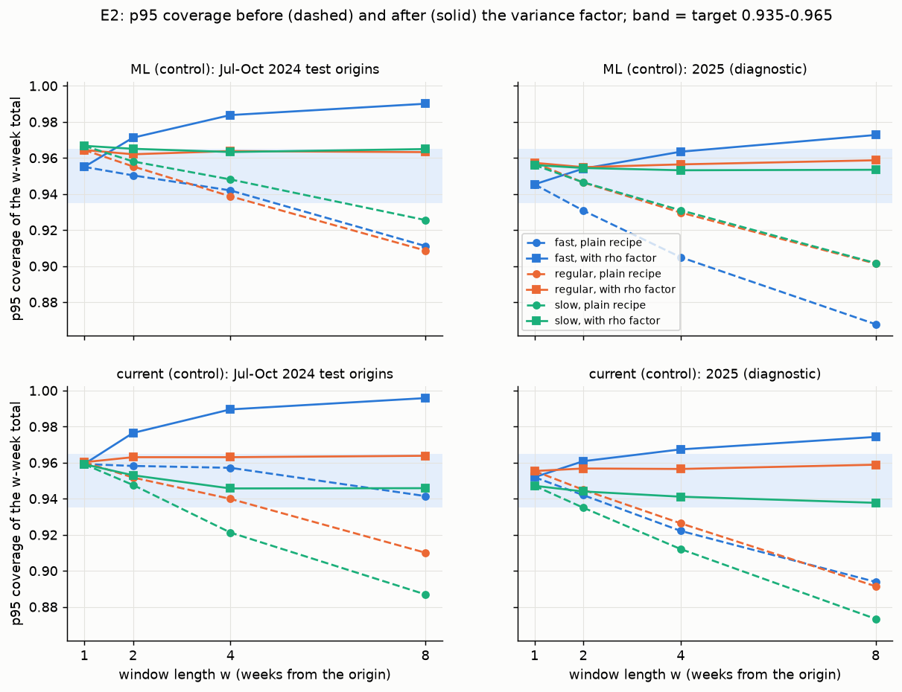

*Coverage of 1, 2, 4 and 8-week totals from the origin. Dashed = plain recipe, solid =
with ρ. The blue band is the target 0.935-0.965.*

Not run: the reported-only replay at k = 1 (nothing was adopted, and the replay budget
went to E6).

## E3. Eid repair (pre-registered, plus one post-hoc arm)

**What changed** (details in [experiment-notes.md](experiment-notes.md#forecast-arms)):

- `src/irpd/forecast.py`: Eid 2026 (20 Mar) and 2027 (10 Mar) added to `EID`. A
  unit-based, unshrunk daily Eid profile (`eid_profile(..., "units")`,
  `predict(eid="units")`). This is `cur_eid`.
- `src/irpd/ml/features/calendar.py`: `c_eid_days` capped at 45 days, day-count
  features (days in −7..−1, Eid day closed, +1..+7, +8..+14), and the units uplift.
  This is `ml_eid`; `ml_eid_censor` adds E4's targets.
- `ml_eid_offset` (**post hoc**): the store-level Eid factor taken out of the tree
  (targets divided by it, forecasts multiplied back). It was designed after seeing the
  2025 placement failure.

**Rule.** Adopt if all of these hold: (c) the unit test passes; the peak is right at
≥ 3 of 4 Eid-2024 origins and at a majority of the 2025 origins whose 8 weeks contain
the actual peak week; Eid-week store absolute % error is lower in both years; pooled
pinball and WAPE are non-inferior on the selection origins.

**(c) Unit test.** `test_eid_days_stays_in_the_training_range_after_sep_2025` and the
other 12 tests in `tests/test_forecast_experiments.py` pass (13/13, re-run for this
report).

**(a) Placement.** Store level = fast + regular + slow drugs. Peak week = the largest of
the origin's 8 weekly totals. The actual peaks are 8 Apr 2024 and 24 Mar 2025 (Eid day
was Mon 31 Mar 2025). The number in brackets is the forecast at its peak divided by the
actual peak.

| origin | cur_control | cur_eid | ml_control | ml_eid | ml_eid_censor | ml_eid_offset (post hoc) |
|---|---|---|---|---|---|---|
| 18 Feb 2024 | ✓ (1.05) | ✓ (1.12) | ✓ (1.05) | ✓ (1.13) | ✓ (1.15) | ✓ (1.09) |
| 3 Mar 2024 | ✓ (1.06) | ✓ (1.13) | ✓ (1.05) | ✓ (1.14) | ✓ (1.17) | ✓ (1.10) |
| 17 Mar 2024 | ✓ (1.08) | ✓ (1.14) | ✓ (1.01) | ✓ (1.13) | ✓ (1.16) | ✓ (1.08) |
| 31 Mar 2024 | ✓ (1.08) | ✓ (1.14) | ✓ (0.98) | ✓ (1.10) | ✓ (1.11) | ✓ (1.09) |
| 2 Feb 2025 | ✓ (0.88) | ✓ (0.99) | ✓ (0.86) | ✓ (0.84) | ✓ (0.84) | ✓ (0.99) |
| 16 Feb 2025 | late (0.92) | ✓ (1.01) | late (0.99) | late (1.15) | late (1.14) | ✓ (1.07) |
| 2 Mar 2025 | late (0.92) | ✓ (1.02) | late (0.95) | late (1.10) | late (1.10) | ✓ (1.01) |
| 16 Mar 2025 | late (0.90) | ✓ (1.00) | late (0.94) | late (1.06) | late (1.07) | ✓ (1.00) |
| **right, 2024 / 2025** | 4/4, 1/4 | **4/4, 4/4** | 4/4, 1/4 | 4/4, 1/4 | 4/4, 1/4 | 4/4, 4/4 |

("late" = forecast peak in the week of 31 Mar, one week after the real peak. The 2 Feb
2025 origin is trivially right: its 8 weeks end on 24 Mar.)

**Eid-week store error.** Σ|forecast − actual| / Σ actual over Eid weeks −4..+3 at the
placement origins.

| arm | 2024 | 2025 (diag.) |
|---|---|---|
| cur_control | 0.053 | 0.067 |
| cur_eid | **0.094** | 0.055 |
| ml_control | 0.041 | 0.081 |
| ml_eid | 0.063 | 0.117 |
| ml_eid_censor | 0.071 | 0.118 |
| ml_eid_offset (post hoc) | 0.078 | 0.068 |

**(b) Pooled scores, selection origins.** Change vs the control, with 90% CI.

| arm vs control | pinball_lc | unit WAPE | NI? (pinball / WAPE) |
|---|---|---|---|
| cur_eid vs cur_control | +0.18% (−0.36%, +0.72%) | +0.18% (−0.31%, +0.71%) | yes / yes |
| ml_eid vs ml_control | +0.39% (−0.63%, **+1.55%**) | +0.30% (−0.12%, +0.75%) | **no** / yes |
| ml_eid_censor vs ml_censor | +0.25% (−0.76%, **+1.30%**) | −0.08% (−0.50%, +0.35%) | no / yes |
| ml_eid_offset vs ml_control (post hoc) | +0.77% (−0.73%, **+2.13%**) | +0.24% (−0.26%, +0.77%) | no / yes |

In 2025 (diagnostic) every Eid arm lowers pooled pinball (−0.4% to −1.2%).

**Verdict.**

- **Current forecaster: not adopted.** It is the only pre-registered arm that fixes
  placement, and it is non-inferior. It fails one condition: with only Eid 2023 to
  learn from, the unshrunk unit profile overshoots the 2024 peak by 12-14%. That makes
  the 2024 Eid-week error worse (0.094 vs 0.053). In 2025 it is better (0.055 vs 0.067).
- **ML: not adopted.** The day-count features don't move the 2025 peak. No training week
  ever had 7 pre-Eid days, and a tree can't extrapolate to a new split of days. Pinball
  is not non-inferior, and Eid-week error is worse in both years.
- **ML Eid offset (post hoc): cannot be adopted on this evidence.** It places 2025 right,
  but it was built after looking at 2025. It also overshoots 2024 and fails pinball NI.
  Eid 2026 (E7) is its only clean test.
- The date list and the 45-day cap ship regardless, as the plan says.

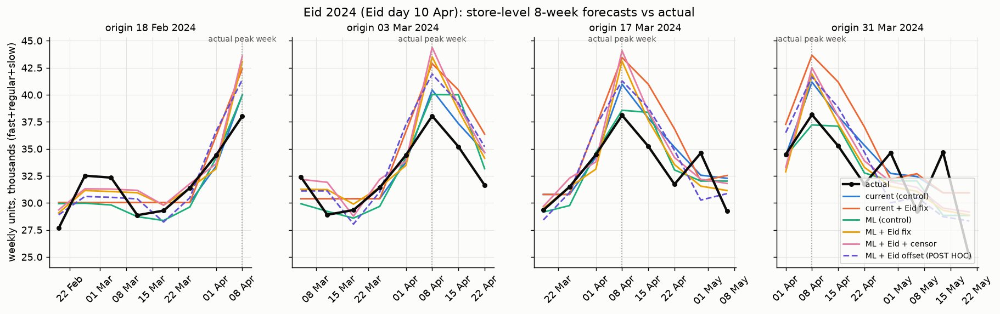

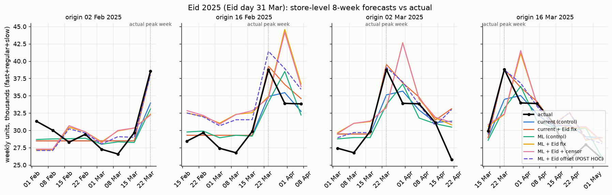

*Black = actual. All arms catch the 2024 peak; the Eid arms overshoot it. In 2025 the
controls and both pre-registered ML Eid arms peak a week late (31 Mar). cur_eid and the
post-hoc offset arm (dashed violet) peak in the right week.*

## E4. Censoring-aware training targets (pre-registered)

**What changed.** `src/irpd/ml/censor.py` (new): weeks with a total stock-out get a
day-by-day uncensored estimate as their training target (rate before the spell × the
day's traffic, nothing from after the day). Shelf-out weeks are kept and flagged
(`d_tgt_shelf`). Arms: `ml_censor`, and `ml_eid_censor` on top of the Eid arm.

**Rule.** Adopt if the censored segment's 4-week bias against uncensored demand is in
[0.95, 1.05], the slow tier's bias is no further from 1 than the control's, and pooled
pinball is non-inferior. Segment labels are taken at each origin (20%+ of the last 26
weeks with a total stock-out day). E2 adopted nothing, so pinball uses the plain spread.

**4-week bias, selection origins.** Gross = against `lost.uncensored_units`. Net =
the lost part multiplied by (1 − the drug's stock-out switch rate); this is an
approximation, reported only.

| segment | ml_control | ml_censor | ml_eid | ml_eid_censor | cur_control |
|---|---|---|---|---|---|
| censored (gate), gross | 2.16 | **2.28** | 2.18 | 2.29 | 2.06 |
| censored, net of switching | 2.22 | 2.35 | 2.25 | 2.36 | 2.12 |
| slow tier (gate) | 1.172 | **1.242** | 1.171 | 1.232 | 1.100 |
| fast | 1.017 | 1.024 | 1.016 | 1.017 | 1.062 |
| regular | 1.099 | 1.119 | 1.095 | 1.111 | 1.085 |
| not censored | 1.005 | 1.013 | 1.002 | 1.005 | 1.034 |

Pooled pinball, ml_censor vs ml_control: +0.43% (−0.33%, **+1.19%**), not non-inferior.
ml_eid_censor vs ml_eid: +0.28% (−0.62%, +1.18%), not non-inferior. Rare-tier pinball
improves a lot (−10.8%), but rare is not a gate.

**2025 (diagnostic)** reverses part of this. ml_censor pooled pinball is −1.9% (−3.5%,
−0.5%), −9.8% on censored windows, and −14.5% on slow censored windows.

**Reported replay, censored drugs** (H2 2024, start 8 Jul, 82 drugs labelled censored at
any re-plan origin, all arms at the same total stock): net stock-out loss on these
drugs is 0.598 Rp M for current, 0.587 for ML, and 0.583 for ML + censor. That is too
small a difference to read anything into.

**Verdict: not adopted.** The censored bias is far outside the band, and the change moves
it further from 1. The slow tier moves away from 1 too. Pinball misses NI by 0.19 points.

**Why the bias is 2, not the plan's 0.91 (exploratory).** Splitting censored-segment
windows by how many of their 4 weeks hold a stock-out shows the cause:

| stock-out weeks in the 4-week window | windows | ml_control bias | ml_censor bias |
|---|---|---|---|
| 0 | 3,664 | 1.06 | 1.10 |
| 1 | 681 | 0.98 | 1.03 |
| 2 | 520 | 1.05 | 1.11 |
| 3 | 419 | 1.37 | 1.40 |
| 4 (out all month) | 6,661 | 18.2 | 19.5 |

More than half the censored-segment windows are out of stock all month. The uncensored
estimator stops after 28 days of a spell, so their "truth" is almost zero. The gate is
measuring the truth's gap, not the forecast. On windows with stock, the control is
already within or near the band, and the censoring change pushes it up by 4-6 points.
The plan's 0.91 came from hindsight labels; with labels taken at the origin it
doesn't reproduce. A better test needs a truth that covers long spells, or a rule that
scores only windows with stock.

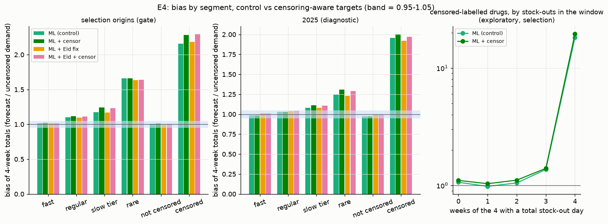

## E5. Lifecycle and sporadic rules (pre-registered)

**What changed.** `forecast.tsb` (TSB, α_p = 0.15) and `ml/segments.py` (labels at the
origin). The fading arm replaces mean and variance with TSB for drugs with no sale in
the last 13 weeks, and stops reordering once TSB rate × 26 < 1 (`stop_flag`). The
sporadic rule (rare tier or ≥ 85% zero weeks) sets s = 0 and S = the largest single
sales line in the last 52 weeks. Both are applied in the replay through a policy hook in
`scripts/results/replay_util.py` (`make_plan_hook`), not in the package code.

**Rule.** Adopt each rule separately if it frees ≥ 5% of the affected drugs' average stock
value at equal pooled net lost revenue (within the 7.5% margin), and adds no more than
2 stock-out days per affected drug per half-year. Hypothesis: fading bias drops from
about 1.26 to below 1.1.

**Replay, H2 2024** (14-day re-plan, starts 8 and 22 Jul; each rule run at the
reference's matched k, so stock freed is read at the reference's loss level).

| base | rule | affected drugs | stock freed on them | pooled net lost ratio (90% CI) | extra stock-out days / drug |
|---|---|---|---|---|---|
| ML | fading → TSB | 42-43 | **0.8%** | 1.007 (0.99, 1.09) | **4.6** |
| ML | sporadic min-stock | 4 | 5.6% | 1.026 (1.00, 1.25) | **5.4** |
| current | fading → TSB | 42-43 | −1.5% | 0.992 (0.93, 1.00) | **2.5** |
| current | sporadic min-stock | 4 | 27.5% | 1.029 (1.00, 1.32) | **6.1** |

One drug (SW2106001723) loses more than Rp 50k under the sporadic rule in every run; it
should be reviewed by a pharmacist.

**Bias, selection origins, 4-week totals** (truth = uncensored demand).

| segment | ML | ML, fading → TSB | current | current, fading → TSB |
|---|---|---|---|---|
| fading, all windows | 8.32 | 6.46 | 6.64 | 6.46 |
| fading, windows with no stock-out week (exploratory) | 2.11 | 0.59 | 0.82 | 0.59 |
| sporadic (base forecaster) | 1.60 | | 1.40 | |

Swapping TSB into ML is pinball non-inferior overall (+0.26%, upper +0.85%), but slow-tier
pinball is +1.2% (upper +2.6%).

**Verdict: neither rule adopted.** The fading rule frees almost no stock in the replay and
adds stock-out days. The sporadic rule frees stock but adds 5-6 stock-out days per drug.
Two limits matter more than the numbers. (1) The replay covers only the 857 fast and
regular drugs, so the rules touch 43 and 4 drugs. Sporadic and fading drugs are mostly
in the slow and rare tiers, which this replay can't test at all. (2) The fading label
mixes drugs whose demand died with drugs that sat out of stock for 13 weeks: 55% of
fading windows are out of stock all month. On windows with stock, TSB overshoots
downwards (bias 0.59). So the "drop below 1.1" hypothesis can't be judged with this
truth.

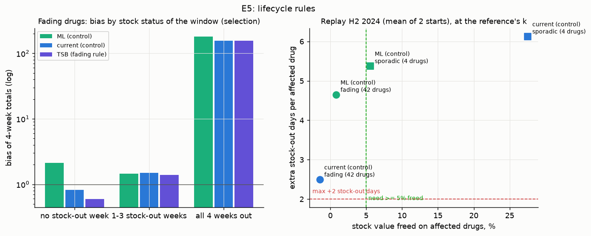

## E6. Default forecaster (pre-registered)

**What changed.** Nothing from E2-E5 was adopted, so the arms are the controls:
`ml_control`, `cur_control`, and an equal-weight ensemble. The ensemble's mean is the
average of the two means and its variance the average of the two variances (a plain
choice; the plan fixes no recipe). Script: `scripts/results/e6.py`.

**Rule.** ML becomes the default if: pooled pinball is superior (upper bound < 0); no
gate tier is worse beyond the margin; the replay is non-inferior in every window; and
4- and 8-week bias is within [0.97, 1.03] for fast and regular. The ensemble replaces ML
only if it beats ML on pooled pinball with an upper bound below 0.

**Pinball, selection origins (gate).** Change vs reference, 90% CI.

| comparison | pooled | fast | regular | slow | rare (not gated) |
|---|---|---|---|---|---|
| ML vs current | **−5.1%** (−7.9%, −2.5%) | +0.1% (−3.3%, **+4.1%**) | −1.7% (−4.0%, +0.7%) | −11.2% (−17.4%, −5.7%) | −24.7% |
| ensemble vs current | −5.4% (−7.8%, −3.3%) | −1.3% (−3.2%, +0.5%) | −2.2% (−3.7%, −0.8%) | −10.6% | −31.4% |
| ensemble vs ML | −0.3% (−1.5%, **+0.8%**) | −1.4% | −0.5% | +0.7% | −8.9% |

Other ML vs current, selection: CRPS −2.2% (−3.5%, −0.9%), revenue-weighted 4-week WAPE
−2.0% (−3.3%, −0.6%), unit WAPE +0.1% (−1.8%, +1.9%).

**2025 (diagnostic).** ML vs current pooled pinball −3.4% (−6.2%, −0.6%); fast +2.8%
(−2.8%, +9.9%); regular −1.0%; slow −8.4%. Ensemble vs ML −1.2% (−2.8%, +0.2%).

**Bias, selection origins.**

| tier | ML 4-wk | ML 8-wk | current 4-wk | current 8-wk | ML 4-wk, windows without stock-out |
|---|---|---|---|---|---|
| fast | 1.017 | 1.019 | 1.062 | 1.069 | 1.002 |
| regular | **1.099** | **1.084** | 1.085 | 1.076 | 1.019 |
| slow | 1.172 | 1.172 | 1.100 | 1.105 | 1.008 |

**Replay** (rolling 14-day; current matched to the pharmacist's stock, ML and ensemble
matched to current's stock). Ratio of net stock-out lost revenue to current's, 90% CI.

| window | start | ML | ensemble | stock-out days, ML / current |
|---|---|---|---|---|
| H2 2024 | 8 Jul | 0.970 (0.42, 1.30) | 0.961 | 338 / 447 |
| H2 2024 | 22 Jul | 1.039 (0.41, 2.24) | 0.913 | 397 / 497 |
| **H2 2024 mean** | | **1.004** | 0.937 | |
| H1 2025 (diag.) | 6 Jan | 0.981 (0.48, 1.09) | 1.019 | 339 / 351 |
| H1 2025 (diag.) | 20 Jan | 1.017 (0.73, 3.03) | 1.004 | 319 / 315 |
| **H1 2025 mean** | | **0.999** | 1.011 | |

Fill rate (0.93-0.94) and cycle service (0.96-0.98) at matched stock are the same for all
arms to within 0.01. The replay is non-inferior (ratio ≤ 1.075) in both windows run.

**Verdict: the rule is not met, so ML does not become the default.** Pooled pinball is
superior. The replay is non-inferior. Two conditions fail:

- **Fast tier.** The point estimate is a tie (+0.1%), but the upper bound is +4.1%, so
  non-inferiority can't be shown. If "worse beyond the margin" is read as "shown worse",
  this passes, since the lower bound is −3.3%. Either way the next point decides.
- **Regular-tier bias** is 1.10 on all windows (gate). On windows without a stock-out it
  is 1.02, inside the band. The gap is again the long-stock-out truth problem from E4.

The ensemble doesn't beat ML (upper bound +0.8%), so it isn't adopted. The practical
reading matches the plan's fallback: ML is better on the primary score and not worse
in the replay, but the test can't separate them in the fast and regular tiers. Keep the
owner's choice with both shown, and record that.

Not run: the H2 2025 replay. Each new window needs the current forecaster computed for
every re-plan day (as fallback for drugs an arm lacks). That took about 30 minutes per
window, so the E6 replays used about 47 minutes against a ~30-minute budget, and we
stopped there.

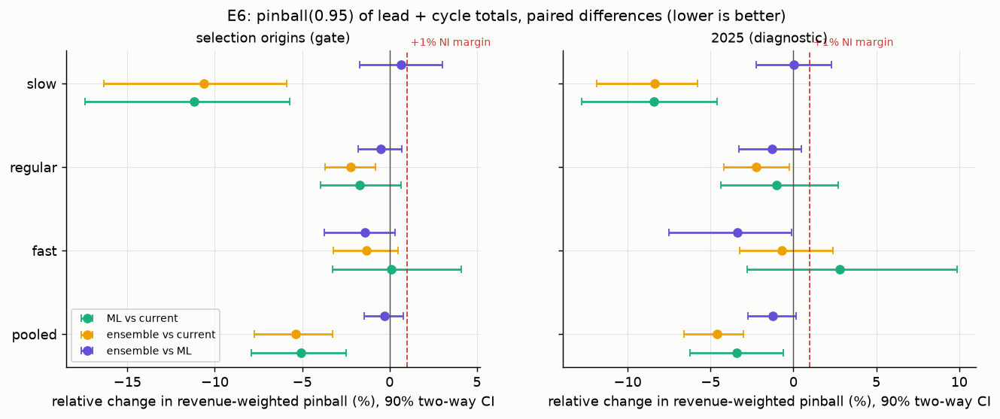

---

## Predictions

All forecast paths below are the arms' stored predictions. Nothing was refitted.

### Store level

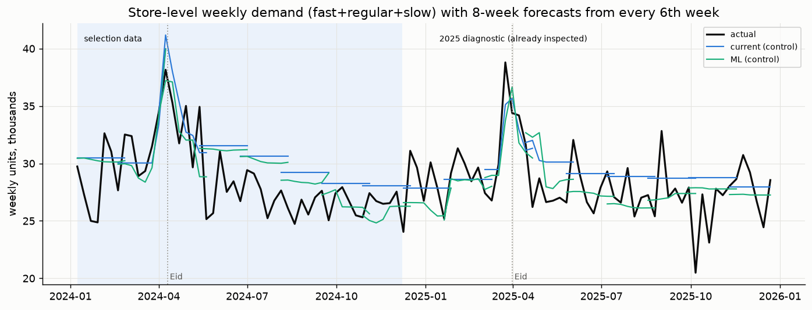

Weekly units of fast + regular + slow drugs, with 8-week paths from every 6th grid
origin. Both forecasters are flat between Eids and follow the level well. ML tracks the
late-2024 decline more closely; current sits higher through most of 2025. The two Eid
plots in E3 zoom in on the peaks.

### Representative drugs

Each plot shows weekly recorded units (solid black), the uncensored estimate (dotted),
and weeks with a total stock-out day (shaded). Forecasts are shown from four origins:
17 Mar 2024 and 2 Mar 2025 (both before Eid), 18 Aug 2024, and 31 Aug 2025. The solid
coloured line is the weekly mean; the dashed line and band are the weekly p95.

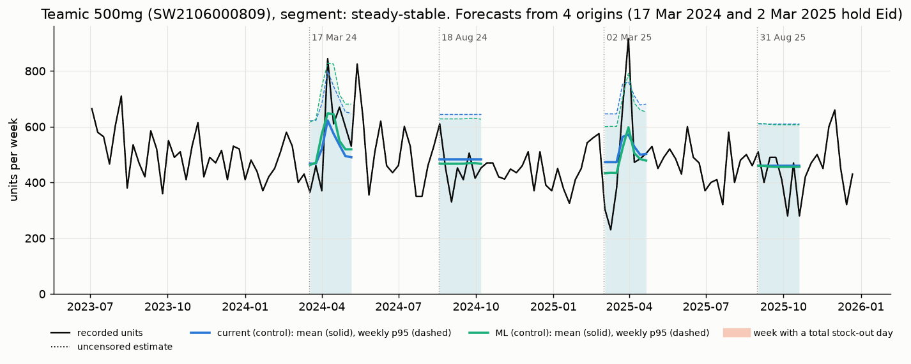

Teamic 500mg (steady-stable, fast). ML and current are almost the same and sit on the
level. Both put an Eid bump in the right place. In 2025 the real swing is much bigger
than forecast: a dip to about 230 units, then a peak of about 920, against a p95 of
about 760-790.

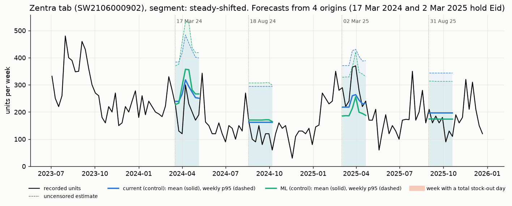

Zentra tab (steady-shifted, fast). At the March 2024 origin ML puts the Eid bump too high
(about 360 forecast vs 300 sold). At the March 2025 origin both under-call the peak
(about 370 sold vs about 260 forecast), and the actual sits on the p95 line. In August
both are flat; in 2024 they sit slightly above sales, which had fallen.

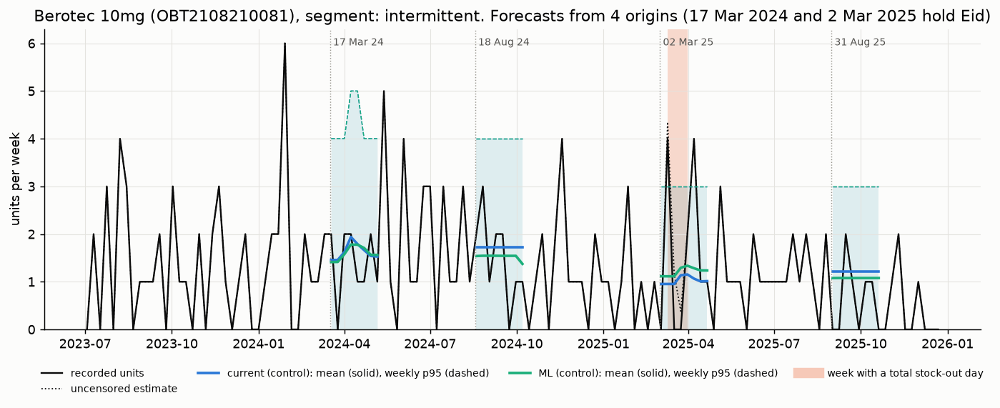

Berotec 10mg (intermittent, regular). The mean is a low flat line of 1-2 units a week,
which is the right forecast for this pattern. The p95 (3-5 units) matters more here; it
covers most weeks, but single spikes of 4-6 units still go over it.

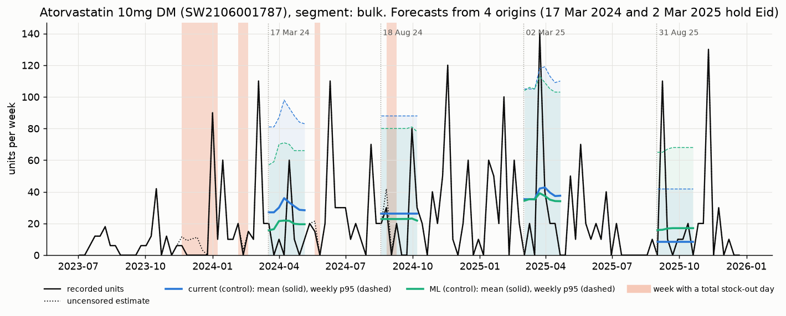

Atorvastatin 10mg DM (bulk, regular). Big one-off orders (60-140 units in a week) drive
the totals. No mean catches them, and several land above p95. This is why bulk drugs need
their own spread model, not a better mean. The forecasters also disagree here: at the
31 Aug 2025 origin current says about 8 a week and ML about 17.

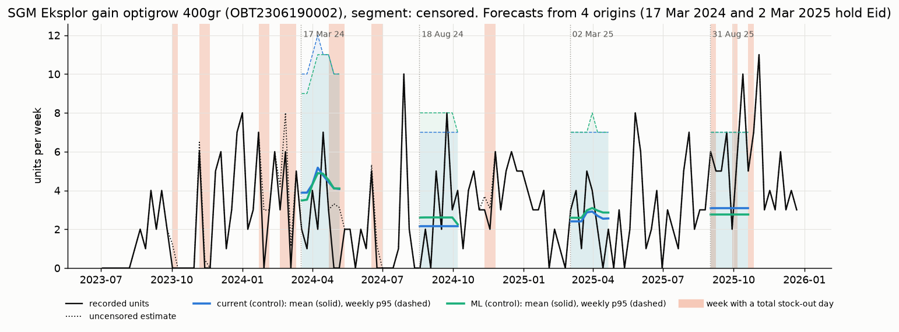

SGM Eksplor gain optigrow 400gr (censored, regular). Stock-outs are frequent (shaded),
and some weeks have an uncensored estimate above recorded sales (dotted). Both
forecasters give about 4-5 units a week in spring 2024 and about 2.5-3 in spring 2025.
Recorded sales swing from 0 to 7 around them. ML and current are close.

---

## Caveats

- **2025 has been inspected.** It is used once per experiment, as a diagnostic. No 2025
  result here can certify a gain. Several pre-registered fixes look better on 2025 than
  on the gate set (E2, E3 for current, E4). That is suggestive at best.
- **The ML Eid offset arm is post hoc.** It was built after the 2025 placement failure
  was seen. Its 4-of-4 2025 placement is not evidence. Eid 2026 is its only clean test.
- **Power.** Only two Eids can be tested. The replay can't rank forecasters (E0: noise
  made it look better), so it is only a guard. Two-way replay intervals span roughly
  0.4-2.2 in ratio.
- **Truth for censored and fading drugs.** The uncensored estimate stops after 28 days of a
  spell. Bias gates on those segments mostly measure that gap (E4, E5).
- **Replay coverage.** The replay holds only the 857 fast and regular drugs. It can't test
  rules aimed at slow, rare, sporadic or fading drugs.
- **Choices we made where the plan was silent**, all fixed before looking at the affected
  result: the common (origin, drug) scoring set; Eid-window classification for the
  Eid-split ρ; the ensemble variance; reading "equal pooled net lost revenue" in E5 as
  "same k as the reference, loss within the 7.5% margin"; the max single sales line for
  the sporadic S; the switch-netted truth in E4 using rates from 30 Jun / 31 Dec 2024.
- **Bias windows.** The plan's 13-week bias is an 8-week bias (forecasts stop at h = 8).
- **No 2026 data.** Sales end 31 Dec 2025. Nothing here is a clean test. Anything later
  adopted from this work is "adopted on development evidence" until E7 runs on 2026 data.

## How to reproduce

Run from the repo root. The stored predictions must be in `data/followup/preds/` first
(see [README.md](README.md)), and `scripts/harness/build_data.py` must have written the
daily truth. Scores and replays are cached in `data/followup/cache/`.

```bash
uv run python eda/followup/scripts/results/e2.py       # variance factor              ~1 min
uv run python eda/followup/scripts/results/e3.py       # Eid placement and scores     ~1 min
uv run python eda/followup/scripts/results/e4.py
uv run python eda/followup/scripts/results/e4_diag.py
uv run python eda/followup/scripts/results/e5.py       # bias part + H2 2024 replays  ~1 min
uv run python eda/followup/scripts/results/e5_diag.py
uv run python eda/followup/scripts/results/e6.py       # scores, replays, verdict     ~50 min (replays dominate)
uv run python eda/followup/scripts/results/gates.py    # gate values for the summary chart
uv run --with matplotlib python eda/followup/scripts/results/figs.py  # all figures -> eda/followup/fig/results/
```

Shared code: `common.py` (loaders, common drug set, price-column workaround, score cache),
`rescore.py` (per-window variance factor for the Eid-split ρ), `replay_util.py` (policy
hook for E5). Outputs go to `data/followup/results/` (CSV tables, `*_verdict.json`, logs).
Cached score objects (about 1.4 GB) can be deleted. The E0 and E1 scripts are in
`scripts/harness/` and `scripts/replan/e1.py`.
